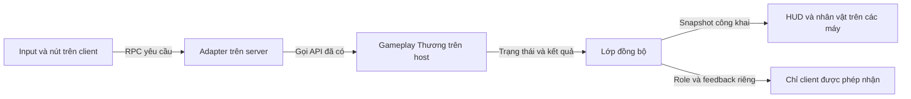

# Hướng dẫn triển khai OnlineSceneGame

Ngày: 12/10/2026. Đây là thiết kế triển khai dựa trên code đang có, chưa phải bản multiplayer đã được tạo hoặc kiểm thử. Các đoạn code minh họa là hướng dẫn cho bước triển khai.

## 1. Kết quả cần đạt

Giữ `Assets/Scenes/Thuong/Prototype/ThuongGameplayPrototype.unity` làm scene offline dự phòng. Dựng scene gameplay mới tại `Assets/Integration/ThuongLoi/Scenes/OnlineSceneGame.unity`, với map và art trung cổ top-down của Thương, kết nối mạng từ phần Lợi và các adapter mới.

Một người tạo phòng và làm host. Host vừa chơi vừa chạy server. Những người khác tham gia dưới dạng client. Server giữ dữ liệu thật của ván; client gửi yêu cầu và hiển thị kết quả. Relay, nếu dùng, chỉ chuyển tiếp kết nối: gameplay vẫn chạy trên host.



Trong lượt triển khai này, chỉ thêm file vào thư mục tích hợp, tài liệu và công cụ riêng. Không chỉnh script, scene, prefab hoặc `.meta` gốc của Lợi/Thương/Nhật; không sửa package và cấu hình chung. Không Apply prefab override về prefab gốc.

## 2. Chuẩn bị và lưu bản dự phòng

1. Ghi nhận trạng thái nền hiện tại: commit, file đã sửa và file chưa được Git theo dõi, bao gồm art top-down vừa nhập. Không reset các thay đổi này.
2. Lưu snapshot nguồn có đủ scene, script, prefab, art và cấu hình phụ thuộc. Lưu bên ngoài `Assets` để không import thêm bộ asset có GUID trùng. Có thể dùng archive nguồn và manifest SHA-256 trong `Logs/ThuongLoiBaseline/`; bỏ qua `Library`, `Temp`, cache và file build.
3. Giữ scene offline ở đường dẫn hiện tại. Thử mở scene và chạy regression trước khi dùng nó làm mốc đối chiếu.
4. Khi bắt đầu viết code tích hợp, làm trên nhánh `codex/thuong-loi-integration` từ nền đã lưu. Tách phần art đã làm khỏi commit phần nối multiplayer.
5. Tạo các thư mục `Scenes`, `Prefabs`, `Runtime`, `Editor`, `Data` trong `Assets/Integration/ThuongLoi/`. Runtime dùng namespace `Team4.Integration.ThuongLoi`; Editor code nằm trong thư mục `Editor`. Không thêm asmdef yêu cầu đổi assembly của code gốc.

Scene offline là bản dự phòng để chạy riêng. Snapshot nguồn mới là cách khôi phục cả phiên bản script/asset được scene tham chiếu.

## 3. File mới cần viết và nhiệm vụ của từng file

| File dự kiến | Nhiệm vụ | Gắn ở đâu |
| --- | --- | --- |
| `IntegrationSessionFlow.cs` | Host/join/leave, tải scene mạng, khóa phòng khi bắt đầu, xử lý mất kết nối. | SessionRoot tồn tại từ menu tới khi rời phòng. |
| `IntegrationRelayConnector.cs` | Khởi tạo Unity Services, đăng nhập, tạo/join session qua Relay bằng mã phòng. | SessionRoot; dùng cho kết nối Internet. |
| `IntegrationLobbyState.cs` | Roster lobby, tên người chơi, trạng thái sẵn sàng và quyền Start của host. | NetworkObject trong lobby mới. |
| `IntegrationMatchBootstrap.cs` | Chốt roster, kích hoạt gameplay server, spawn player, chờ client sẵn sàng rồi BeginGame một lần. | MatchRoot của OnlineSceneGame. |
| `IntegrationMatchSync.cs` | Đọc manager server, tạo snapshot công khai và dữ liệu riêng cho từng owner. | MatchRoot, có NetworkObject. |
| `IntegrationNetworkTypes.cs` | Struct snapshot/request/result và serialization Netcode. | Không gắn vào GameObject. |
| `IntegrationMovement.cs` | Input owner, RPC hướng đi, server physics, trạng thái hướng nhìn/animation. | Network player. |
| `IntegrationGameplayRequests.cs` | Request nhiệm vụ, kỹ năng, vote, xác nhận role; kiểm tra sender và gọi API gameplay. | Network player. |
| `IntegrationPlayerPresentation.cs` | Skin, Animator, tên, vòng chọn và nối camera local. | Network player/Visual. |
| `IntegrationHudPresenter.cs` | HUD, role card, nút kỹ năng, danh sách mục tiêu, vote, kết quả ván. | Canvas local trong OnlineSceneGame. |
| `IntegrationStationPresenter.cs` | Mã station, task asset, vị trí tương tác, marker và phím E của người local. | Mỗi điểm nhiệm vụ. |
| `IntegrationWorldPresenter.cs` | Màu đêm/ngày từ snapshot mạng và các hiệu ứng chỉ để hiển thị. | WorldPresentation. |
| `IntegrationGameConfig.cs` + `.asset` | Tham chiếu cast, role catalog, bảng 6 station, giới hạn người chơi và cấu hình tích hợp. | Asset mới trong Data. |
| `IntegrationSceneBuilder.cs` | Dựng các scene/prefab mới, nối reference, kiểm tra GUID và component. | Editor. |
| `IntegrationBuild.cs` | Build với danh sách scene riêng. | Editor. |
| `IntegrationChecks.cs` | Kiểm tra reference, phạm vi thay đổi và các ca tích hợp. | Editor; bổ sung runtime harness nếu cần. |

Các file có thể gộp nếu chức năng nhỏ. Đây là phân chia trách nhiệm, không phải yêu cầu tạo đủ từng file rỗng.

## 4. Dựng menu, lobby và cấu hình kết nối

### 4.1. Scene menu mới

Tạo `ThuongLoiMainMenu.unity`, gồm Canvas, EventSystem và `SessionRoot`. SessionRoot chứa đúng một `NetworkManager`, `UnityTransport`, `NetworkManagerPersistent` của Lợi và `IntegrationSessionFlow` mới.

Cấu hình trước khi gọi StartHost/StartClient hoặc tạo session Relay:

- Dùng mô hình client/server, bật scene management của Netcode.
- Dùng asset `IntegrationNetworkPrefabs.asset` riêng, đăng ký prefab player mới.
- Bật connection approval. Callback kiểm tra phòng còn ở lobby, số người chưa vượt giới hạn và cấu hình/version tương thích.
- Approval trả `CreatePlayerObject = false`; không tự sinh nhân vật gameplay ngay khi vào menu/lobby. Bản đầu dùng manual spawn khi vào OnlineSceneGame.
- Không đưa thêm NetworkManager vào lobby hoặc gameplay. Root persistent có guard để không tạo bản thứ hai khi quay lại menu.
- Mọi máy dùng cùng bản build. Giới hạn đề xuất là 20 người, phù hợp bộ 20 skin hiện tại; đặt trong config mới.

Nút Host/Join/Leave của scene mới trỏ đến `IntegrationSessionFlow`. Không dùng callback chuyển scene của `NetworkUI` và `SceneLoader` cũ vì chúng đang tải cứng `Lobby`/`MainMenu`.

### 4.2. Kết nối khi thử trên một máy hoặc LAN

Phần Lợi hiện lưu cả địa chỉ kết nối và địa chỉ listen là `127.0.0.1`, cổng 7777. Cấu hình này phù hợp thử trên cùng máy. Để máy khác trong LAN tham gia, cấu hình transport trong scene mới trước khi bắt đầu:

```csharp
// Host: mở listen cho các địa chỉ của máy host.
transport.SetConnectionData("127.0.0.1", 7777, "0.0.0.0");
networkManager.StartHost();

// Client LAN: hostLanAddress là IP LAN của máy host.
transport.SetConnectionData(hostLanAddress, 7777);
networkManager.StartClient();
```

Hai nhánh trên chạy ở hai máy/instance khác nhau. Sau khi host khởi động thành công, host tải lobby mới bằng NetworkSceneManager. Client chờ Netcode kết nối và đồng bộ scene; không tự gọi SceneManager.LoadScene để theo host. Cần bảo đảm mạng/firewall cho phép kết nối khi kiểm tra LAN.

### 4.3. Kết nối Internet qua Relay

Project đã có `com.unity.services.multiplayer` 2.3.1 và Netcode 2.13.2. Dùng Multiplayer Services SDK đang cài, không cài thêm bộ Relay/Lobby SDK cũ song song.

1. Kiểm tra project Unity Gaming Services và environment hiện tại đã được liên kết/cấu hình cho Authentication và Relay. Nếu cấu hình chưa sẵn, ghi rõ đây là việc cần hoàn thành trước thử Internet; không tự đổi ProjectSettings trong phần tích hợp gameplay.
2. `IntegrationRelayConnector` gọi `UnityServices.InitializeAsync()`, rồi `AuthenticationService.Instance.SignInAnonymouslyAsync()` nếu chưa đăng nhập. Khi chạy nhiều instance trên cùng máy, dùng profile test riêng để tránh dùng chung người dùng đã cache.
3. Host tạo session, ví dụ `new SessionOptions { MaxPlayers = 20 }.WithRelayNetwork()`, sau đó gọi `MultiplayerService.Instance.CreateSessionAsync(options)` và hiển thị `session.Code`.
4. Client nhập mã, gọi `MultiplayerService.Instance.JoinSessionByCodeAsync(code)`.
5. SDK điều phối việc khởi động networking. Không gọi thêm StartHost/StartClient của nhánh LAN sau khi chọn luồng Relay; code package hiện tại đã gọi chúng trong network handler.
6. Sau khi networking thực sự sẵn sàng, host dùng cùng luồng tải lobby và gameplay của IntegrationSessionFlow. Tạo session thành công không có nghĩa mọi client đã tải xong scene.
7. Khi rời phòng Relay, dùng `session.LeaveAsync()` và xử lý sự kiện kết thúc mạng; tránh gọi nhiều luồng shutdown đồng thời.

Cách tạo session và vòng đời networking được đối chiếu với [Unity Create a session](https://docs.unity.com/en-us/mps-sdk/create-session), [Session networking](https://docs.unity.com/en-us/mps-sdk/session-networking) và [Relay servers](https://docs.unity.com/en-us/mps-sdk/networking/relay-servers). LAN chỉ là bước thử; để nhận bản Internet hoàn chỉnh cần kiểm tra giữa hai mạng khác nhau.

### 4.4. Lobby mới

Tạo `ThuongLoiLobby.unity` với Canvas, EventSystem và LobbyRoot có NetworkObject + IntegrationLobbyState. Server cập nhật roster qua callback connected/disconnected. Client chỉ gửi tên và Ready; server chuẩn hóa tên, lưu trạng thái và đồng bộ danh sách.

Có thể dùng `LobbyManager` của Lợi cho danh sách đơn giản nếu không bổ sung Ready. Nếu dùng nó, nút Start phải đổi callback trong scene mới sang IntegrationSessionFlow; không gọi `LobbyManager.StartGame()` tải scene `Game` cũ. Hướng đầy đủ có Ready dùng IntegrationLobbyState mới, không chạy cả hai lớp cùng quản lý một roster.

Khi host nhấn Start: kiểm tra Ready theo chính sách lobby, chốt danh sách client, khóa nhận người mới, rồi gọi:

```csharp
networkManager.SceneManager.LoadScene("OnlineSceneGame", LoadSceneMode.Single);
```

Kiểm tra trạng thái trả về của lệnh tải scene; nếu không bắt đầu được, mở lại lobby và báo lỗi. Không mở gameplay bằng local SceneManager khi phòng còn kết nối.

Nếu quyết định tải scene tiếp theo phát sinh trong callback scene đang chạy, chỉ ghi yêu cầu và thực hiện sau khi callback kết thúc. Không tạo thêm scene event chồng lên event tải hiện tại.

## 5. Dựng OnlineSceneGame từ đầu

Hierarchy dự kiến:

```text
OnlineSceneGame
  Main Camera                 Camera orthographic + ThuongTopDownCamera
  EventSystem                 InputSystemUIInputModule
  World                       Tilemap, nhà, cây, vật cản; art của Thương
  TaskStations                6 station với IntegrationStationPresenter
  WorldPresentation           Theme, depth sort, torch loop, world presenter
  MatchRoot                   NetworkObject + MatchBootstrap + MatchSync
  ServerGameplayRoot          Ban đầu inactive, không có NetworkObject
    PlayerManager             prototypeLobbySize = 0, players rỗng
    RoleManager               roleDefinitions = GameplayRoles.asset
    TaskManager               6 task asset, tasksPerDay = 4
    DayTimer                  dayDuration = 45
    NightManager
    VoteManager
    DeathResolver
    WinConditionManager       giữ cấu hình luật của prototype
    StatusEffectSystem
    AbilitySystem
    GameRoleManager           ban đầu disabled, manualLogicPrototype = false
    Các manager hỗ trợ role cần thiết từ code hiện có
  ClientCanvas                IntegrationHudPresenter; có ở cả host và client
```

ServerGameplayRoot chỉ active trên server. Host vẫn có ClientCanvas để chơi như các client khác. Client không kích hoạt root này, không tạo PlayerData/role của mọi người và không chạy timer gameplay offline.

Nối reference bằng builder/Inspector trong scene mới:

- `GameRoleManager.statusEffects` → StatusEffectSystem; `abilities` → AbilitySystem.
- `AbilitySystem.phaseController` → GameRoleManager; `nightSystem` → NightManager.
- `StatusEffectSystem.deathSystem` → DeathResolver.
- RoleManager trỏ catalog `Assets/Scenes/Thuong/Prototype/Integration/GameplayRoles.asset`.
- Cast trỏ `Assets/Scenes/Thuong/Prototype/Art/Medieval/Unity/MedievalCast.asset`.
- Các task asset lấy từ `Assets/Scenes/Thuong/Prototype/Data/Task1.asset` tới `Task6.asset`.
- Manager hỗ trợ như LoverManager, nếu đường role yêu cầu, dùng component từ code đã có; chỉ thêm instance vào scene mới.

Giữ thời lượng prototype: role reveal 25 giây, ngày 45 giây, đêm 20 giây, discussion 8 giây, vote 10 giây. Giữ các cấu hình task, death, win và role khác theo scene offline, không tự đổi sang luật loại hết sói thắng nếu cấu hình hiện tại không bật.

Không đặt spawner offline, PrototypeControls, GameHUD/RoleAbilityUI/VoteButton offline, NetworkRoleManager, NetworkGameTimer, NetworkPhaseTimerController, NetworkVoteStateManager, NetworkRoleActionBridge hoặc các script Network*Test trong scene này. Chúng được thay bằng component tích hợp tại các vị trí tương ứng; file gốc không bị sửa.

## 6. Prefab network player mới

Tạo prefab variant từ `Assets/Prefabs/Loi/Player.prefab`, lưu thành `NetworkMedievalPlayer.prefab` trong thư mục tích hợp. Variant có cấu trúc:

```text
NetworkMedievalPlayer
  NetworkObject
  Rigidbody2D / collider chân
  NetworkTransform            AuthorityMode = Server, đồng bộ XY
  NetworkRigidbody2D           physics chỉ chạy ở phía có authority
  NetworkPlayerStateSync      dùng lại từ Lợi
  NetworkRoleSync             thông báo role ban đầu cho owner
  IntegrationMovement
  IntegrationGameplayRequests
  IntegrationPlayerPresentation
  Visual                      SpriteRenderer + Animator
  NameLabel / SelectionRing
```

Loại `PlayerController`, `NetworkPlayerVote`, `NetworkPlayerAction` và `NetworkPlayerDataBridge` khỏi variant. Bootstrap mới là nơi đăng ký PlayerData duy nhất; requests mới xử lý luật phù hợp. Các component gốc vẫn còn nguyên trong prefab Lợi. Không chỉ uncheck component có logic OnNetworkSpawn rồi giả định nó không chạy: Netcode hiện tại vẫn có đường gọi OnNetworkSpawn cho behaviour trên object active.

Danh sách network prefab riêng phải đăng ký đúng variant, không vô tình dùng player gốc. Sau khi tạo variant, kiểm tra GlobalObjectIdHash/hash đăng ký, không có entry trùng hoặc entry còn trỏ prefab cũ; mọi client phải có cùng cấu trúc và thứ tự NetworkBehaviour của prefab mới.

Đặt gravity = 0, freeze rotation Z, collider chân khoảng 0.42 × 0.23 và tốc độ 3 như prototype top-down. Dùng visual scale, pivot chân và sorting theo Y hiện có. Chỉ đồng bộ vị trí XY; camera, HUD, tint đêm và sorting được tính local.

NetworkTransform trong prefab Lợi hiện là Owner authority. Override thành Server trong variant và cấu hình topology client/server; không dùng Distributed Authority cho thiết kế này.

## 7. Thứ tự khởi tạo một ván

### 7.1. Cửa chờ tải scene

IntegrationSessionFlow đăng ký sự kiện scene trước khi gọi LoadScene. Dùng `OnLoadEventCompleted` của Netcode; chữ ký package hiện tại cung cấp `sceneName`, `loadSceneMode`, `clientsCompleted`, `clientsTimedOut`.

Chỉ tiếp tục nếu scene là OnlineSceneGame, roster đã chốt đều tải xong, không có timeout/mất người và MatchRoot đã network spawn. Nếu có lỗi, hủy việc bắt đầu và quay về lobby. Không chỉ chờ một lần `sceneLoaded` local hoặc đợi số giây cố định.

### 7.2. Khởi tạo server và spawn

1. Trên server, active ServerGameplayRoot. Các Awake thiết lập singleton, nhưng GameRoleManager vẫn disabled nên chưa tự chạy Start.
2. Kiểm tra đủ manager và reference. Không dùng `manualLogicPrototype = true` để chặn auto-start: nó còn khiến BeginGame từ chối chạy và tắt logic tích hợp.
3. Đăng ký một PlayerData mới cho mỗi client trong roster, bằng `PlayerManager.RegisterPlayer()`. Không gọi CreateTestPlayer hoặc NetworkGamePlayerBootstrap cùng lúc.
4. Bản đầu giữ `playerID = checked((int)clientId)`. Kiểm tra phạm vi và trùng ID trước bước này. Những bridge hiện tại, đặc biệt hook `DeathResolver` → `NetworkPlayerStateSync`, đang dùng quy ước đó.
5. Tên hiển thị/skin dùng `rosterIndex` riêng: P01..P20, skin 0..19. Không giả định client ID liên tục hoặc bằng thứ tự nhân vật.
6. Instantiate và cấu hình mỗi prefab player, sau đó `SpawnAsPlayerObject(clientId, true)`. Mỗi client có đúng một PlayerObject. Chọn vị trí spawn không chồng nhau và nằm trên đường đi hợp lệ.
7. Client nhận player object, nối visual/HUD/camera và gửi Ready của scene về MatchRoot. Ready này khác Ready trong lobby; server kiểm tra sender thuộc roster. Endpoint trên MatchRoot không thuộc client nên quyền gọi RPC phải cho phép client, kèm validation sender.
8. Chờ tất cả client Ready với timeout hữu hạn. Nếu đủ, subscribe event gameplay, bật GameRoleManager và gọi BeginGame một lần từ bootstrap. Start của GameRoleManager gọi lại cũng an toàn nhờ cờ `started`, nhưng bootstrap vẫn phải có guard riêng theo matchId.
9. BeginGame chia role. NetworkRoleSync gửi role ban đầu riêng cho từng owner. MatchSync gửi snapshot công khai và thông tin kỹ năng riêng. UI chưa nhận role thì hiện đang chờ; không tự đoán hoặc random role.

Mỗi ván có matchId mới và các player object mới. NetworkRoleSync có `roleSent` chỉ gửi một lần trên mỗi instance, vì vậy không giữ nguyên player object để chia role lại ván sau.

## 8. Dữ liệu cần đồng bộ

### 8.1. Snapshot công khai

Thiết kế `IntegrationMatchSnapshot` có `INetworkSerializable` và so sánh thay đổi phù hợp. Có thể dùng một NetworkVariable với ReadPermission.Everyone, WritePermission.Server cho toàn bộ snapshot công khai nhỏ; tạo giá trị mới khi cập nhật, không sửa ngầm array bên trong giá trị cũ.

| Nhóm | Trường cần có |
| --- | --- |
| Phiên ván | matchId, revision, trạng thái Loading/Running/Finished/Aborted, lý do hủy nếu có. |
| Luồng | currentDay, currentPhase, currentState, phaseToken. |
| Thời gian | thời điểm hết phase theo ServerTime; phase nào đang có countdown. |
| Người chơi | playerID, ownerClientId, displayName, rosterIndex/skinIndex, connected, isAlive. |
| Nhiệm vụ | bảng station ID, active/completed, totalProgress, dailyProgress. |
| Kết quả | thông tin vote đã được phép công bố, người bị loại, winner từ server. |

Không đưa role, faction của mọi người, toàn bộ PlayerData, effect nguồn, đối tượng BaseRole hoặc pending night action vào snapshot công khai. Seed chia role và debug log có role cũng không gửi cho client. Snapshot public nhỏ không chứa dữ liệu chuyển động cập nhật liên tục; movement dùng NetworkTransform và trạng thái animation trên player riêng.

### 8.2. Dữ liệu riêng của owner

Gửi bằng owner-only NetworkVariable trên PlayerObject hoặc RPC nhắm đúng owner: role của chính họ, faction hiện tại, skill được phép dùng, số lượt còn lại, bùa Shaman còn lại, trạng thái WhiteHound thức tỉnh, quyền Hunter đặt bẫy, phiếu đã chọn của chính họ và feedback riêng.

NetworkRoleSync dùng cho thông báo role lúc đầu. Private snapshot đầy đủ là dữ liệu để dựng UI và cập nhật sau biến đổi; không chỉ dựa vào event role ban đầu. Subscribe trước khi nhận role, đồng thời đọc giá trị đã nhận khi HUD được tạo muộn.

Không đọc private field của role/AbilitySystem để lấy số lượt. Dùng API công khai như ValidateActor, hasUseNightAction, HasGoodCharm/HasBadCharm, HasUsedAllNightActions; nếu cần hiển thị chính xác số lần đã bấm, adapter giữ bộ đếm phục vụ UI từ những request server đã chấp nhận và reset theo lượt phase. Bộ đếm UI không thay validator gameplay làm nguồn quyết định có được dùng kỹ năng hay không.

### 8.3. Lúc nào gửi lại snapshot

- Subscribe `GameRoleManager.PhaseChanged`, `PlayerManager.AliveStateChanged`, `PlayerData.Changed`, `AbilitySystem.AbilityResolved`, `VoteManager.VoteResolved`, `DeathResolver.DeathResolved` và event effect cần thiết.
- Sau request nhiệm vụ thành công, đánh dấu dữ liệu task cần gửi lại: TaskManager không có event hoàn thành task riêng hiện tại.
- Event chỉ đánh dấu dirty; đọc và publish ở LateUpdate hoặc cuối frame. `PhaseChanged` có thể phát trước khi timer/tasks được gán xong trong cùng hàm, nên gửi ngay trong callback dễ lấy trạng thái cũ.
- Khi đổi phase, thời gian còn lại lấy từ `DayTimer.TimeRemaining` nếu currentState là Day; các phase có thời gian khác lấy `GameRoleManager.PhaseTimeRemaining`. Tính deadline từ `NetworkManager.ServerTime.Time + remaining` khi capture.
- Client hiển thị countdown từ deadline và thời gian server ước lượng. Hết số giây trên UI không được tự gọi EndDay/FinishNight/FinishVoting. Chỉ các manager server chuyển phase.
- ResolveNight/ResolveVote có thể diễn ra trong một frame; thông báo kết quả gửi dạng event/result riêng để client vẫn nhận được dù snapshot chỉ thấy phase sau đó.

## 9. Di chuyển và camera top-down

1. IntegrationMovement chỉ đọc input nếu IsOwner. Dùng InputAction riêng với WASD/mũi tên/gamepad, không chỉnh Input Actions asset chung.
2. Gửi hướng, sequence và matchId lên server, đề xuất 20 lần/giây và khi hướng thay đổi. Movement là dữ liệu liên tục, có thể gửi unreliable; task/skill/vote dùng reliable.
3. Với RPC mới trên PlayerObject, dùng quyền owner của phiên bản Netcode hiện tại, ví dụ `[Rpc(SendTo.Server, InvokePermission = RpcInvokePermission.Owner)]`. Server vẫn kiểm tra sender/OwnerClientId và roster; host cũng đi cùng đường request.
4. Server kiểm tra input hữu hạn, clamp độ dài <= 1, bỏ sequence cũ, kiểm tra ván đang chạy, actor sống và currentState = Day. Không nhận tọa độ/tốc độ do client tự gửi làm kết quả chính thức.
5. FixedUpdate trên server dùng Rigidbody2D để di chuyển ở tốc độ 3. Khi phase đổi hoặc không được di chuyển, velocity về 0. Nếu mất input quá thời gian cấu hình, dừng lại, tránh đi mãi do mất gói.
6. NetworkTransform phát vị trí và interpolation cho client. NetworkRigidbody2D tránh physics client đánh nhau với vị trí từ server. Bản đầu dùng server movement; prediction chỉ bổ sung khi đo độ trễ cho thấy cần, không đồng thời chạy PlayerController cũ.
7. Gửi hướng nhìn và trạng thái walking từ server; Animator local nhận `isWalking`, `isDead`, `LastInputX`, `LastInputY`. Lấy controller/skin từ MedievalCast.
8. IntegrationPlayerPresentation chỉ gọi `ThuongTopDownCamera.Follow(playerTransform)` khi object thuộc local owner. Giữ camera orthographic và bounds của map; Tab overview vẫn là thao tác camera local. Không đồng bộ camera qua mạng.

## 10. Chuyển nhiệm vụ offline sang online

Tạo bảng ID cố định trong config mới. Không dùng thứ tự FindObjectsByType để quyết định ID.

| Station ID | Asset | Nhiệm vụ | Vị trí nền top-down | Bán kính |
| --- | --- | --- | --- | --- |
| 0 | Task1.asset | Lấy nước | (-6, -2) | 1.3 |
| 1 | Task2.asset | Thu hoạch | (-7, 3) | 1.3 |
| 2 | Task3.asset | Sửa rào | (8, 3) | 1.3 |
| 3 | Task4.asset | Gom củi | (-7, -6) | 1.3 |
| 4 | Task5.asset | Dọn kho | (8, -4) | 1.3 |
| 5 | Task6.asset | Thắp đèn | (1, 5) | 1.3 |

Các asset nằm trong `Assets/Scenes/Thuong/Prototype/Data/`, hiện mỗi task có progressValue = 10. Giữ 4 task ngẫu nhiên mỗi ngày; tổng tiến độ và tiến độ ngày được tính bằng TaskManager trên server.

Luồng khi nhấn E:

```text
Client local đứng gần station đang active → gửi CompleteTask(stationId)
Server lấy actor từ SenderClientId → kiểm tra ván/phase/sống/vị trí
Server tra task asset → TaskManager.TryCompleteTask(actorId, task)
Thành công → capture snapshot mới → mọi client cập nhật marker và tiến độ
Thất bại → trả feedback riêng cho requester
```

TaskManager kiểm tra ngày, người sống, nhiệm vụ đang hoạt động và chống hoàn thành trùng; khoảng cách phải được adapter server kiểm tra thêm vì API hiện tại không có điều kiện khoảng cách. Chỉ dùng vị trí server, không tin kết quả kiểm tra gần station do client gửi.

Hai người gửi cùng task trong một lúc vẫn chỉ cộng 10% tổng một lần. Với 4 task/ngày, một task thành công tương ứng 25% tiến độ ngày. Đạt 100% tổng thì TaskManager gọi VillagerWin trên server; client nhận winner, không tự tính thắng.

## 11. Chuyển kỹ năng và vote sang online

### 11.1. Gói request chung

Request có matchId, requestId, phaseToken, loại hành động và target/station ID. Actor lấy từ `rpcParams.Receive.SenderClientId`, tra roster rồi lấy PlayerData đã đăng ký. Không nhận actor ID do UI lựa chọn.

phaseToken định danh lượt phase cụ thể, không chỉ tên Night/Voting: request trễ từ đêm trước không được dùng trong đêm mới. Chặn request của ván cũ. Cache kết quả requestId có giới hạn để retry cùng request không tiêu thêm kỹ năng hoặc cộng task hai lần. Request mới hợp lệ được xử lý theo luật gameplay hiện tại.

Result có matchId, requestId, trạng thái Accepted/Rejected/Resolved và feedback; gửi riêng cho requester nếu là dữ liệu riêng. UI khóa nút trong lúc chờ ack, cập nhật theo response, nhưng server vẫn phải kiểm tra ngay cả khi client cố gửi lại.

### 11.2. Các lệnh kỹ năng

| Lệnh | Server làm gì | Thông tin trả về |
| --- | --- | --- |
| NightAbility(targetId) | `RoleManager.UseNightAbility(actorId, targetId, out feedback)`. | Ghi nhận/từ chối; kết quả xử lý đêm gửi sau nếu ability được queue. |
| ShamanGoodCharm/ShamanBadCharm(targetId) | Xác nhận actor thực sự là ShamanRole, Night, còn sống, chưa hết lượt và không bị khóa; gọi SelectCharm loại tương ứng rồi UseNightAbility. | Loại bùa còn lại và feedback riêng. Chọn bùa và dùng lên mục tiêu trong cùng request. |
| HunterTrap(targetId) | Xác nhận đúng HunterRole, actor đã chết, còn hasHunterTrap, phase Discussion; gọi `HunterRole.TrySetTrap()`. | Ack và quyền đặt bẫy mới; việc resolve vẫn do GameRoleManager. |
| RevealRead | Lưu người đó đã đọc role/ẩn card local. | Xác nhận riêng, không cho một client bỏ qua reveal của toàn phòng. |

Không gọi `NetworkRoleActionBridge` cũ vì nó gửi role chính xác của mục tiêu Tiên Tri. SeerRole hiện trả Dog Spirit/không phải Dog Spirit qua feedback: chỉ người soi nhận được. Dog Spirit và Guardian có ability được queue; Accepted không có nghĩa mục tiêu đã chết/đã được resolve ngay lúc bấm.

Giữ quy tắc Guardian không chọn mình/không lặp mục tiêu hai đêm liền, mục tiêu Sói chung, SerpentSpirit chỉ từ đêm thứ ba, Killer ở đêm chẵn, WhiteHound cần thức tỉnh và FoxSpirit tối đa hai action. Các điều kiện này do API/RoleActionRules hiện có xử lý; adapter không tạo bộ luật thứ hai. Kiểm tra riêng UI owner để hiển thị đúng khả năng còn lại.

Không áp dụng một chốt `actor phải sống` cho mọi loại request: HunterTrap là ngoại lệ hợp lệ sau khi chết. Những kỹ năng nội tại của các role còn lại tiếp tục được server chạy qua callback gameplay; không tạo nút RPC mới cho kỹ năng chưa có thao tác trong prototype.

### 11.3. Vote

Khi vào Voting, GameRoleManager server gọi StartVote đúng một lần. Client mở danh sách theo roster public, chọn mục tiêu và gửi Vote(targetId). Server kiểm tra phaseToken, actor/target và gọi `VoteManager.TryVote(actorId, targetId)`.

Không đưa NetworkPlayerVote vào variant vì nó dựng lại toàn bộ phiếu và cho đổi phiếu. Không gọi StartVote khi nhận từng request. Phiếu lần hai bị từ chối theo luật Thương; nút chỉ khóa sau ack hợp lệ. Không tự thêm điều kiện cấm vote chính mình nếu API/luật prototype hiện tại cho phép.

Hết thời gian, GameRoleManager gọi FinishVoting, VoteManager.ResolveVote và xử lý trap/win theo flow gốc. VoteResolution chuyển thành DTO công khai đã chọn lọc. Không gửi nguyên object PlayerData/BaseRole trong kết quả mạng.

## 12. HUD, death và kết quả ván

- HUD mới giữ art giấy/gỗ, portrait, thanh tiến độ, danh sách task, phase/day/time, bảng vote và thông báo kết quả của Thương; các presenter đọc snapshot mạng.
- Các nút gửi request qua PlayerObject local. Không gắn GameHUD/RoleAbilityUI/VoteButton offline rồi cố sửa private field hoặc tái tạo role của mọi người trên client để chúng chạy.
- Theme, torch loop và depth sort là phần trình bày có thể dùng lại. ThuongVillageMood và ThuongTopDownCharacter phụ thuộc manager offline, nên thay phần đọc trạng thái bằng world/player presenter mới.
- Chỉ server gọi DeathResolver. Hook có sẵn sẽ cập nhật NetworkPlayerStateSync bằng playerID tương ứng clientID. MatchSync đồng thời đọc trạng thái sống thật để cập nhật roster công khai.
- Lúc vào Night, có thể biểu diễn người sống bằng trạng thái Sleeping; sang Day khôi phục Alive. Không ghi đè Dead/Spectating khi đổi phase. Quyền kỹ năng đọc luật gameplay, không coi Sleeping là đã chết.
- Người bị loại xem ván theo UI/camera phù hợp; movement/task/vote bị khóa. Hunter vẫn hiện nút đặt bẫy khi luật cho phép.
- Winner lấy từ GameRoleManager.Winner. Xử lý Aborted riêng, không gán giả một phe thắng khi kết nối bị mất. Thông báo công khai chỉ chứa điều luật cho phép biết; không broadcast toàn bộ feedback kỹ năng riêng.
- Bảng Discussion/Voting chưa tự tạo hệ thống chat/voice. Nếu muốn trò chuyện trong game, đó là hạng mục bổ sung; bản chuyển gameplay online vẫn dùng bảng phase/thời gian hiện có.

## 13. Thoát phòng, hủy ván và chơi lại

Đề xuất bản đầu: cho join ở lobby, khóa join từ khi chốt roster; chưa hỗ trợ reconnect giữa ván hay chuyển host.

- Một client rời lobby: xóa khỏi roster, cập nhật Ready/Start.
- Một client mất kết nối lúc tải hoặc trong ván: đánh dấu Aborted, dừng GameRoleManager, StopTimer và tắt MatchIsRunning, gửi lý do công khai. Sau khi xử lý sự kiện hiện tại xong, host tải lobby mới cho những người còn kết nối. Không gọi LoadScene chồng trong callback tải scene đang chạy.
- Host thoát: client kết thúc session/network, hiện lý do và về menu tích hợp. Không dùng SceneLoader cũ quay về menu Lợi.
- Chơi lại: despawn player cũ, hủy root gameplay cũ, tạo lại từ scene mới và matchId mới. Không dùng ResetLogicMatch vì hàm đó dành cho manualLogicPrototype.
- Hủy subscription event ở OnNetworkDespawn/OnDestroy, hủy coroutine/async đang chờ, reset cache request, ready set và dữ liệu UI. Kiểm tra các singleton không có reset OnDestroy: lần khởi tạo sau phải thiết lập lại đúng instance và không có Update sống từ ván trước.
- Với Relay, về lobby cho người còn trong phòng có thể giữ session/network; rời phòng hoàn toàn dùng LeaveAsync. Giữ một luồng chịu trách nhiệm shutdown để tránh callback trùng.

## 14. Build và kiểm thử theo thứ tự

### 14.1. Build riêng

IntegrationBuild truyền `BuildPlayerOptions.scenes` theo thứ tự:

```text
Assets/Integration/ThuongLoi/Scenes/ThuongLoiMainMenu.unity
Assets/Integration/ThuongLoi/Scenes/ThuongLoiLobby.unity
Assets/Integration/ThuongLoi/Scenes/OnlineSceneGame.unity
```

Output riêng, ví dụ `Builds/ThuongLoi/Windows/WerewolfOnline.exe`. Không stage binary hoặc cache. Không sửa danh sách scene chung trong EditorBuildSettings. Netcode dùng danh sách scene trong build; với giới hạn này, kiểm tra toàn bộ menu/lobby/scene load bằng các bản executable của build riêng. Chạy trực tiếp luồng mới trong Editor có thể cần cấu hình scene test riêng, không tự sửa build list chung để tiện test.

### 14.2. Các mốc và điều kiện đạt

| Mốc | Bài kiểm tra | Điều kiện đạt |
| --- | --- | --- |
| A. Scene/prefab | Compile, reference, GUID, map/collider, fingerprint nguồn. | Không thiếu script; không có component offline cạnh tranh; scene offline còn nguyên. |
| B. Mạng cơ bản | 1 host + 2 client cùng máy, sau đó 2 máy LAN. | Kết nối và tải cùng scene; mỗi client có đúng một nhân vật/camera local. |
| C. Movement | WASD 4 hướng, đứng lại, đổi phase, dead, lag/mất gói mô phỏng. | Chỉ owner điều khiển; physics server; không xuyên vật cản hoặc đi tiếp do stale input. |
| D. Gameplay | Task đồng thời, skills, reveal, night/vote, death, ngày mới, win. | Luật giống offline; task chỉ +10 một lần; vote lần hai bị chặn; không double resolve. |
| E. Role đầy đủ | Bài kiểm tra có role cốt lõi được bố trí rõ, rồi pool/role đặc biệt hiện có. | Seer riêng tư; Shaman bùa đúng; Hunter sau chết; Fox hai lượt; role biến đổi cập nhật owner UI. |
| F. Quyền request | Giả actor, gọi từ object khác, phaseToken/matchId cũ, target sai, task xa, spam. | Server từ chối theo đúng loại hành động; HunterTrap hợp lệ vẫn được nhận. |
| G. Vòng đời | Timeout tải, client/host thoát, chơi lại nhiều lần. | Hủy ván đúng; không giữ role/vote/timer/subscription cũ. |
| H. Internet | Relay giữa hai mạng khác nhau, nhập mã, thoát và tạo phòng mới. | Không phụ thuộc IP loopback/LAN; luồng scene và gameplay vẫn đồng bộ. |
| I. Regression | Regression Thương và menu/lobby/game gốc của Lợi. | Các bản gốc chạy độc lập; file gốc, Packages và ProjectSettings không đổi. |

Đối với bài kiểm tra role cốt lõi, không giả định 4 người sẽ ngẫu nhiên được đủ Dog Spirit/Seer/Guardian/Villager. RolePoolBuilder hiện lấy role đặc biệt theo pool; harness kiểm tra phải có roster/role bố trí rõ hoặc seed đã xác nhận cho ca đó. Ván chính thức vẫn dùng pool hiện tại, không giới hạn về 4 role.

Tăng dần kiểm tra tới 20 người để đo băng thông và độ mượt; chỉ công bố giới hạn hỗ trợ sau khi chạy đủ. Bản hoàn chỉnh phải đạt cả gameplay, vòng đời và Internet nếu mục tiêu là chơi ngoài LAN.

## 15. Ranh giới hoàn thành và merge

Trình tự triển khai: lưu nền → scene/config/prefab → lobby/load/spawn → movement/camera → snapshot/role/timer → task → ability → vote/death/win → rematch/disconnect → Relay → regression/build.

Trước khi merge, so sánh manifest nguồn với nền và kiểm tra diff chỉ thêm file tích hợp/tài liệu. Stage theo đường dẫn; không dùng git add toàn workspace. Giữ `.meta` của file mới, kiểm tra GUID duy nhất và prefab variant không có Apply vào gốc.

Việc chỉ thêm file giúp tránh sửa chồng lên công việc của hai tác giả. Nếu họ đổi API, prefab hoặc asset nền về sau, cần chạy lại integration checks; merge Git sạch không thay thế kiểm tra hành vi.
