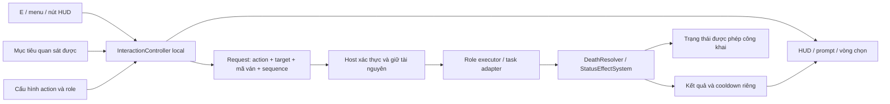

# Kế hoạch tương tác người chơi bằng E và kỹ năng tức thời

Ngày: 28/10/2026. Nền code khảo sát: `058f41f` trên nhánh local `thuong`.

Trạng thái: thiết kế đề xuất để triển khai, chưa thay đổi gameplay hoặc scene.

## 1. Hướng đã được người dùng chọn

- Một phím **E** để thực hiện tương tác theo ngữ cảnh.
- **Giữ E** để chọn hành động khi có nhiều kỹ năng hoặc nhiều loại tương tác.
- Giết người, bảo vệ, soi và các kỹ năng chủ động có hiệu lực ngay sau thao tác hợp lệ và được host xác nhận; không chờ tổng kết cuối đêm.
- Có HUD, biểu tượng hành động, nhãn phím, mục tiêu được đánh dấu và phản hồi rõ ràng, lấy cảm hứng từ Goose Goose Duck / Among Us.

Các thông số như khoảng cách, thời gian giữ phím, cooldown và thời hạn trả thù dưới đây là giá trị thử nghiệm, chưa phải thông số cân bằng cuối.

## 2. Hiện trạng và phạm vi tích hợp

Luồng đang bật trong `ProjectSettings/EditorBuildSettings.asset` là:

`Assets/Scenes/Loi/MainMenu.unity → Lobby.unity → Game.unity → Result.unity`.

Đây là luồng ưu tiên triển khai. Scene `Assets/Scenes/Thuong/OnlineSceneGamePlay.unity` có một phiên online khác và chỉ được nối qua adapter ở đợt sau nếu cần; không chạy hai lớp quyết định kết quả trên cùng một trận.

| Thành phần hiện có | Điểm cần thay đổi hoặc tái sử dụng |
| --- | --- |
| `Assets/Scripts/Loi/PlayerController.cs` | Di chuyển do owner đọc input; Night đang khóa di chuyển. Cần policy cho phép đi lại trong Night của chế độ mới và kiểm tra độ tin cậy vị trí trên host. |
| `Assets/Scripts/Loi/NetworkSkillUI.cs` | Các nút kỹ năng chủ yếu mở panel chọn người, có nhánh riêng cho Shaman/Hunter. Đưa phần hiển thị về một nguồn trạng thái hành động thống nhất. |
| `Assets/Scripts/Loi/NetworkTargetListUI.cs` | Danh sách người chơi hiện tại; thay bằng mục tiêu trong thế giới đối với kỹ năng cự ly gần. Giữ bộ chọn riêng cho ngoại lệ hợp lệ như Hunter trả thù. |
| `Assets/Scripts/Loi/NetworkPlayerAction.cs` | Đã xác thực sender, role/state/phase, mục tiêu và lượt dùng; đường action thông thường giới hạn Night. Cần bổ sung kiểm tra không gian, định danh request và policy mới. |
| `Assets/Scripts/Loi/NetworkRoleActionBridge.cs` | Một phần kỹ năng đã thực hiện trực tiếp, một phần đi qua luật đêm; cần thống nhất thời điểm hiệu lực và tiêu hao. Shaman của luồng này có bảo vệ và giết bằng bùa. |
| `Assets/Scripts/Thuong/Roles-thuongnh/RoleActionRules.cs` và `AbilityValidator.cs` | Có luật ngày/đêm, giới hạn role và mục tiêu. Tách điều kiện chung khỏi điều kiện riêng của kiểu xử lý cuối đêm. |
| `Assets/Scripts/Thuong/Death-thuongnh/DeathResolver.cs` | Tái sử dụng làm điểm xử lý chết: bảo vệ, thức tỉnh WhiteHound, Hunter, người yêu và nguyên nhân chết. |
| `Assets/Scripts/Thuong/Roles-thuongnh/ThuongRoleDefinition.cs` | Đã có tên/icon, loại kỹ năng, phe mục tiêu và số lượt. Bổ sung hoặc liên kết metadata tương tác, tránh tạo danh mục role trùng. |
| `Assets/Scripts/Thuong/Tasks-thuongnh/TaskStation.cs` | Prototype đã đọc E riêng cho task. Không để handler này và bộ điều khiển mới cùng xử lý một lần nhấn trong scene tích hợp. |
| `Assets/Scripts/Thuong/Online/ThuongOnlineSession.cs` | Luồng online riêng hiện đọc E cho task, có request/epoch riêng; dùng adapter khi hỗ trợ scene này. |
| `Assets/Settings/InputSystem_Actions.inputactions` | Đã có action Interact dạng Hold; cần thống nhất xử lý nhấn nhanh/giữ và binding thay vì thêm nhiều đoạn đọc E rời rạc. |

Trong `Game.unity` còn các object thử nghiệm như `NetworkTargetTest`, `NetworkPlayerStateTest`, `NetworkPhaseTest`. Cần kiểm tra trạng thái hoạt động và vô hiệu hóa input debug trong scene/build thử nghiệm mới để tránh phím điều khiển gameplay bị xử lý hai lần.

## 3. Vòng chơi sau cải tiến

Ví dụ: người chơi DogSpirit tiến gần người khác, thấy vòng đánh dấu và HUD `E · Tấn công · Minh`. Nhấn E, host kiểm tra lại vị trí và quyền dùng; nếu hợp lệ, đòn được xử lý ngay. Mục tiêu được bảo vệ có thể sống sót theo luật hiện có. Người tấn công nhận trạng thái kết quả và lượt dùng mới.

Các thay đổi luật đề xuất cho bản đầu:

- Giữ lịch ngày/đêm, phân vai, nhiệm vụ và bỏ phiếu của game hiện tại.
- Trong **Night**, người sống được đi lại và dùng kỹ năng cho phép trong Night ở cự ly phù hợp. Loại bỏ bước tự chuyển người sống sang Sleeping gây khóa di chuyển trong chế độ này.
- Trong **DayStart/Event/Task**, đi lại và làm nhiệm vụ theo policy hiện có; kỹ năng chỉ hoạt động nếu cấu hình của nó cho phép phase đó. Không mặc định mở quyền giết ban ngày cho mọi role.
- **Discussion/Voting/ResolveVote/ResolveNight/RoleReveal/GameOver** khóa tương tác ngoài các ngoại lệ đã định nghĩa. Khi Discussion là cuộc họp, khóa cả di chuyển; đây là thay đổi có chủ ý so với controller hiện tại đang cho đi trong Discussion.
- Số lượt mỗi đêm/mỗi ván vẫn là giới hạn chính trong MVP. Cooldown theo giây không tự thay thế các giới hạn đó.
- Kỹ năng tức thời không còn đăng ký thêm cùng một hiệu ứng vào hàng đợi cuối đêm. Các hiệu ứng có thời gian riêng, như lời nguyền, được áp dụng ngay nhưng vẫn có thể phát tác sau theo định nghĩa role.

Cho phép cấu hình `ClassicQueued` và `RealtimeProximity` để đối chiếu và chạy hồi quy. Luồng mới dùng `RealtimeProximity`; mỗi trận chỉ có một chế độ xử lý.

Nếu sau này muốn giết tự do cả ngày như một chế độ hoàn toàn giống Among Us, bổ sung profile riêng sau khi cân bằng lại phe, thời lượng ván và nhiệm vụ.

## 4. Điều khiển bằng một phím hành động

| Thao tác | Kết quả |
| --- | --- |
| Nhấn nhanh E | Thực hiện đúng hành động và đúng mục tiêu đang hiện trên HUD. |
| Giữ E khoảng 0,3 giây | Mở menu hành động khả dụng. |
| Giữ E + WASD/phím hướng | Chọn ô trong menu; các phím di chuyển được chuyển sang điều hướng menu. |
| Thả E sau khi menu đã mở | Chỉ chọn hành động cho HUD, chưa thi triển. Nhấn nhanh E lần tiếp theo để thực hiện. |
| Thả E khi chưa chọn ô nào / Esc | Đóng menu, không làm gì. |
| E khi đang chat, nhập văn bản, chọn role hoặc chơi minigame | Không gửi action trong thế giới. Input thuộc màn hình đang nhận thao tác. |

E là phím thực hiện hành động duy nhất. WASD/phím hướng chỉ dùng di chuyển hoặc điều hướng; Esc là phím hủy.

Quy tắc xử lý input:

1. Khi nhấn xuống, chụp `actionId`, loại mục tiêu và định danh mục tiêu đang hiển thị.
2. Chỉ thực hiện nhấn nhanh khi thả phím trước ngưỡng giữ. Không bắn ở key-down rồi lại mở menu ở cùng lần giữ.
3. Một chu kỳ nhấn–thả chỉ tạo tối đa một yêu cầu. Bỏ qua keyboard repeat.
4. Khi giữ mở menu, tạm dừng input di chuyển của chính người chơi; thời gian của trận và người khác vẫn chạy.
5. Không đổi mục tiêu hoặc đổi từ Làm nhiệm vụ sang Giết trong lúc phím đang được giữ.
6. Nếu mục tiêu đã rời tầm, chết, ngắt kết nối hoặc phase thay đổi, hủy hoặc báo không thực hiện được. Không tự chuyển đòn sang người kế bên.
7. Mất focus, người chơi chết, scene đổi hoặc bắt đầu minigame phải hủy trạng thái đang nhấn.

## 5. Chọn mục tiêu trong thế giới

Mỗi người chơi local chỉ có một `InteractionController`, với một pipeline chọn mục tiêu dùng chung cho HUD và input.

- Nhóm mục tiêu: người chơi sống, bản thân, trạm nhiệm vụ, vật thể tương tác và xác nếu bật phần báo xác.
- Khoảng cách thử ban đầu cho kỹ năng gần: **1,5 Unity units**, chỉnh theo kích thước nhân vật và map thực tế. Mỗi action có range riêng.
- Ưu tiên mục tiêu trước hướng nhìn, rồi khoảng cách. Giữ mục tiêu hiện tại khi các ứng viên gần tương đương để vòng chọn không nhảy liên tục.
- Kiểm tra vật cản bằng collider/layer của map thực tế; gần về khoảng cách nhưng nằm sau tường vẫn không hợp lệ.
- Nếu đứng yên, dùng hướng nhìn cuối cùng. Hướng nhìn phải được đồng bộ hoặc có quy tắc chọn trên host rõ ràng.
- Với nhiều người chồng nhau, giữ E mở danh sách mục tiêu ngắn cho action đang chọn, chọn bằng phím hướng; không phải dùng chuột để tìm người trong danh sách cả phòng.
- Khi trạm và người chơi cùng nằm trong vùng tương tác, menu phải có lựa chọn rõ như `Làm nhiệm vụ` / `Tấn công Minh`. Hành động tấn công chỉ được gửi nếu HUD đã hiển thị đúng lựa chọn đó tại lúc nhấn.
- Self-target dùng mục `Bản thân` rõ ràng trong menu, không đưa vào thuật toán người gần nhất làm mất mục tiêu bên ngoài.

Không dùng thông tin phe/role/trạng thái bảo vệ bí mật của người khác để bật tắt icon hoặc đổi màu vòng chọn. Với các điều kiện bí mật, host từ chối bằng phản hồi không tiết lộ thông tin vượt quyền của role. Đồng đội đã được phép biết nhau có thể dùng thông tin được cấp chính thức.

Ngoại lệ không cần cự ly, như Hunter trả thù, có `targetMode` riêng. Chỉ action được định nghĩa như vậy mới được chọn mục tiêu ngoài tầm.

## 6. HUD, biểu tượng và phản hồi

### 6.1. Bố cục

- **Trên đầu/chân mục tiêu:** vòng hoặc outline mảnh; tên vẫn đọc được, không che nhân vật.
- **Gần người local:** prompt ngắn, ví dụ `E · Bảo vệ Lan`.
- **Góc dưới phải:** một nút hành động chính gồm icon, tên, phím E, mục tiêu, số lượt và vòng hồi chiêu nếu có.
- **Menu khi giữ E:** tối đa khoảng 4–6 ô dễ đọc; nhiều hơn chuyển sang danh sách ngắn. Mỗi ô có icon, tên và trạng thái dùng được.
- **Kết quả riêng:** thông báo ngắn như `Đã bảo vệ Lan`, `Chờ host xác nhận`, `Mục tiêu đã ra khỏi tầm`. Thông tin soi chỉ gửi cho người được quyền nhận.

Phác thảo nội dung HUD:

```text
                      [ Lan ]
                         ◯        ← mục tiêu đang chọn

                   [E] Bảo vệ Lan

                                        ┌──────────────────────┐
                                        │  Khiên   BẢO VỆ      │
                                        │  [E]     Lan         │
                                        │  Còn 1 lượt đêm này  │
                                        │  Giữ E · Lựa chọn    │
                                        └──────────────────────┘
```

### 6.2. Trạng thái hiển thị

| Trạng thái | Hiển thị |
| --- | --- |
| Sẵn sàng | Icon rõ, nhãn hành động và tên mục tiêu. |
| Chưa có mục tiêu | Icon mờ và `Tiến gần mục tiêu`. |
| Ngoài tầm / bị tường chắn | Icon mờ và lý do dựa trên thông tin quan sát được. |
| Đang chờ xác nhận | Vòng chờ, khóa gửi trùng; chưa hiển thị chết thành công. |
| Hồi chiêu / hết lượt | Thời gian còn lại hoặc `Đã dùng đêm này` / `Hết bùa`. |
| Sai phase / bị khóa kỹ năng | Nhãn lý do của chính người chơi; không chỉ thay màu. |
| Chọn kỹ năng khác | Icon, tên và điều kiện cập nhật đồng thời. |

### 6.3. Bộ icon đề xuất

| Tương tác | Hình nhận diện |
| --- | --- |
| Dùng đồ vật / làm nhiệm vụ | Bàn tay / bánh răng |
| Tấn công | Vuốt / lưỡi dao |
| Bảo vệ | Khiên |
| Soi | Con mắt |
| Bùa lợi / bùa hại | Hai lá bùa có ký hiệu khác nhau |
| Nguyền / mê hoặc | Ấn chú / vòng xoáy |
| Ghép đôi | Hai nút thắt hoặc hai trái tim liên kết |
| Hunter trả thù | Tâm ngắm |
| Báo xác, nếu triển khai | Chuông cảnh báo |

Dùng cùng nét vẽ và độ dày viền, phù hợp art làng hiện tại. Có nhãn chữ đi kèm, không phân biệt bùa lợi/bùa hại chỉ bằng màu. Art gốc do dự án tạo; các game tham khảo dùng để học cách đọc trạng thái.

VFX/SFX kỹ năng bí mật chỉ hiện cho người phù hợp. Không hiện icon role trên đầu mọi người hoặc phát hiệu ứng soi cho cả phòng. Nếu làm chế độ phát hiện xác, rà soát `NetworkDeathNotification` và danh sách người chơi để thông báo tự động không vô tình công khai ngay toàn bộ tình huống.

## 7. Ma trận chuyển kỹ năng role

Đây là mapping đề xuất cho các role có code cụ thể đã tìm thấy. Enum `RoleType` còn nhiều tên khác; phải kiểm tra role catalog và logic thực thi trước khi đưa vào lobby của chế độ mới.

| Role / nhóm | Tương tác bằng E trong chế độ mới | Ràng buộc cần giữ hoặc thiết kế rõ |
| --- | --- | --- |
| Villager và role thụ động như Mayor/Idiot | Nhiệm vụ, đồ vật; báo xác nếu bật. | Không cấp khả năng giết chỉ vì dùng chung controller. |
| DogSpirit / role dùng sharedNightKill | Tấn công người gần, xử lý ngay qua DeathResolver. | Đề xuất giữ một lượt tấn công chung mỗi đêm cho nhóm đang dùng sharedNightKill; đòn đầu được host chấp nhận tiêu hao lượt chung. Không biến một mục tiêu chung cuối đêm thành mỗi sói một mạng. |
| Ogre | Hành động tấn công theo định nghĩa role. | Xác nhận thuộc nhóm dùng lượt chung hay lượt riêng trong catalog; không suy ra chỉ từ faction. |
| SerpentSpirit | Tấn công cự ly gần. | Vẫn mở từ đêm thứ ba theo RoleActionRules. |
| Killer | Tấn công cự ly gần. | Vẫn chỉ đêm chẵn trong bản đầu; không bỏ giới hạn này vì chuyển sang tức thời. |
| VillageGuardian | Bảo vệ người gần hoặc chọn Bản thân. | Áp hiệu ứng ngay; giữ giới hạn không bảo vệ cùng một người hai đêm liên tiếp, số lượt và thời hạn bảo vệ. |
| Seer | Soi người gần; nhận kết quả riêng. | Giữ mức thông tin của luật được chọn; không tự nâng thành tiết lộ mọi role. |
| Shaman | Giữ E chọn Bùa lợi hoặc Bùa hại, E dùng lên mục tiêu. | Luồng Game hiện có bùa bảo vệ và bùa giết; mỗi loại có tài nguyên riêng. Luồng prototype khác có bùa hại gây Silenced, cần adapter theo mode rõ ràng. Bùa lợi trong MVP là bảo vệ, chưa phải hồi sinh. |
| Cursed | Đặt lời nguyền lên người gần. | Áp trạng thái ngay; khóa kỹ năng và thời điểm phát tác phải thống nhất giữa code legacy và configured ability. |
| FoxSpirit | Mê hoặc từng người gần. | Giữ tối đa hai mục tiêu mỗi đêm và không mê lại mục tiêu đã ghi nhận; không để khóa action chung chặn mất lượt thứ hai. |
| WeaverOfFate | E đánh dấu người thứ nhất, di chuyển chọn người thứ hai rồi E hoàn tất. | Hiện tiến độ `1/2`; host lưu lựa chọn tạm và kiểm tra lại cả hai khi hoàn tất. Bản đầu yêu cầu cả hai còn trong tầm khi xác nhận; chưa trừ lượt trước khi ghép thành công. |
| Hunter | Sau khi chết, E dùng quyền bắn trả thù qua bộ chọn riêng. | Ngoại lệ được thao tác khi chết, không hồi sinh. Đề xuất giữ chọn từ xa theo quyền hiện có; giới hạn thời gian và tiếp tục trì hoãn xét thắng khi còn quyền bắn đang xử lý. |
| WhiteHound | Hiệu ứng thức tỉnh đi qua DeathResolver. | Không bỏ hành vi chuyển phe khi chịu đòn phù hợp; cập nhật action được cấp sau chuyển phe. |
| Brat | Cần thiết kế lại thông tin nhìn trộm trong trận tức thời. | `BuildPeekReport()` đang gắn với hệ thống đêm. Chưa tự nối sang log kỹ năng công khai; tạm loại khỏi pool RealtimeProximity cho đến khi định nghĩa nguồn thông tin và giữ được rủi ro bị bắt. |
| Tên role chưa có execution hoàn chỉnh | Chưa mở trong pool mới. | Hoàn tất định nghĩa, quyền dùng, feedback và kiểm thử trước. |

Một số luật thứ tự phải được ghi thành cấu hình và ca kiểm thử:

- Bảo vệ có hiệu lực trước đòn đánh có thể chặn đòn; bấm bảo vệ sau khi mục tiêu đã chết không cứu ngược thời gian.
- Hai yêu cầu đến gần nhau được host xử lý theo thứ tự xác định. Sau khi một người chết, các action thường của người đó bị từ chối; quyền Hunter là ngoại lệ riêng.
- Yêu cầu sai mục tiêu, ngoài tầm hoặc sai phase không tiêu hao tài nguyên.
- Một đòn hợp lệ đã được thi triển nhưng bị bảo vệ chặn vẫn tiêu hao lượt/charge đã định nghĩa. Phân biệt `Bị từ chối` với `Đã thi triển nhưng bị chặn` để tránh spam kiểm tra bảo vệ.
- Đòn dùng lượt chung phải tiêu hao lượt một cách nguyên tử trên host; hai sói nhấn cùng lúc không tạo hai mạng ngoài dự kiến.
- Hiệu ứng nhiều đêm giữ lịch tick theo phase trong MVP. Hiển thị đúng `còn 2 đêm`, không đổi tùy tiện thành countdown giây.

## 8. Kiến trúc đề xuất



Nhóm trách nhiệm dự kiến, không yêu cầu tạo đủ file rỗng nếu có thể gộp:

| Thành phần | Nhiệm vụ |
| --- | --- |
| `InteractionController` + bộ đọc input | Phân biệt tap/hold, context khóa input, action đã chọn và pending request. |
| `InteractionTargetResolver` | Tìm mục tiêu, giữ focus, raycast vật cản, khóa target trong một lần nhấn. |
| `InteractionActionDefinition` / catalog | Icon, tên, loại mục tiêu, range, phase, cách giải quyết và giới hạn. Liên kết role catalog hiện có. |
| `InteractionHUD` + presenter mục tiêu | Cùng đọc một snapshot hiển thị, không tự tính quyền dùng bằng logic riêng. |
| `NetworkInteractionAuthority` | Sender, vòng đời ván, sequence, kiểm tra không gian, chặn yêu cầu trùng, kết quả chính thức. Có thể mở rộng NetworkPlayerAction thay vì dựng một cổng song song. |
| `RealtimeRoleActionExecutor` | Adapter chuyển kỹ năng phù hợp sang hiệu lực ngay, dùng resolver hiện có, quản lý tiêu hao theo kết quả. |
| Adapter task / đối tượng | Mở đúng minigame hoặc thực hiện tương tác. Thành công nhiệm vụ vẫn cần gameplay xác nhận. |
| Adapter riêng cho ThuongOnlineSession | Dùng chung định nghĩa/action state qua cơ chế message của scene đó khi triển khai đợt sau. |

Cấu hình tĩnh có thể dùng ScriptableObject. Cooldown đang chạy, charge còn lại và mục tiêu tạm nằm trong state của người chơi/trận trên host, không ghi vào asset dùng chung.

## 9. Xác thực mạng và xử lý kết quả

Client chỉ gửi ý định. Request có tối thiểu: `matchEpoch`, `phaseRevision`, `requestSequence`, `actionId`, `targetKind`, `targetId`; action hai mục tiêu bổ sung ID thứ hai. Actor luôn lấy từ sender, không tin actor do client khai báo.

Host kiểm tra theo thứ tự:

1. Request thuộc kết nối, ván và phase hiện tại; sequence hợp lệ. Request trùng trả lại kết quả cũ, không thực thi lại.
2. Người gửi còn trong roster, object tồn tại và được quyền thao tác. Kiểm tra lại sống/chết cùng ngoại lệ Hunter.
3. Action thật sự thuộc bộ kỹ năng người gửi, đúng mode và phase; không bị khóa kỹ năng.
4. Còn charge/lượt/cooldown, bao gồm tài nguyên dùng chung của phe nếu action có quy định.
5. Mục tiêu tồn tại, loại mục tiêu đúng, còn hợp lệ; các player/object/client ID được ánh xạ rõ trên host.
6. Khoảng cách và đường nhìn hợp lệ từ vị trí mà host chấp nhận. Không tin kết quả raycast, cờ in-range hoặc vị trí gửi kèm request.
7. Giữ tài nguyên, thực thi một lần; xử lý toàn bộ chuỗi chết/hiệu ứng rồi cập nhật lượt dùng, thông tin riêng và trạng thái mạng.
8. Xét thắng khi chuỗi chết hoàn tất và không còn hành động đặc biệt bắt buộc đang chờ. Không chờ cuối đêm để cập nhật người đã chết tức thời.

Kiểm tra range trên host chưa đủ nếu Transform đang do client tự quyết định. Đợt đầu phải xác minh NetworkTransform và luồng di chuyển thực tế của prefab đang spawn. Nếu owner có thể gửi vị trí tùy ý, thêm kiểm tra tốc độ/collision trên host hoặc chuyển di chuyển sang host mô phỏng từ input trước khi coi range là điều kiện có thể tin cậy.

Đường RPC/action cũ phải tuân theo cùng policy khi mode mới bật. Không để UI mới kiểm tra range nhưng client vẫn gọi endpoint cũ để chọn người toàn map.

Về phản hồi:

- Vòng chọn và trạng thái nút phản hồi ngay trên client; chết, trừ bùa và hiệu ứng chính thức theo host.
- Cooldown có mốc kết thúc theo thời gian host; UI client chỉ hiển thị thời gian còn lại.
- Một action đang chờ không gửi lặp vô hạn. Khi retry do timeout, dùng lại định danh request để tránh thực hiện hai lần.
- Trạng thái công khai không mang killer ID, role bí mật hoặc kết quả soi. Phản hồi private chỉ gửi tới người có quyền.
- Khi chết/rời phòng/chơi lại: xóa action đang giữ, selection tạm, pending, cooldown/charge của ván cũ, đăng ký sự kiện và dữ liệu xác theo đúng vòng đời.

## 10. Xác chết và báo cáo: phần mở rộng có ranh giới rõ

MVP hoàn thành được việc tới gần, dùng kỹ năng, xử lý chết và phản hồi. Cơ chế tìm xác → họp không phải điều kiện để kiểm chứng input và role action, nhưng là đợt tiếp theo phù hợp nếu muốn tăng cảm giác Among Us.

Khi triển khai phần này:

- Host tạo một bản ghi xác cho mỗi lần chết phù hợp, gồm ID, nạn nhân, vị trí và mã ván. Không tạo xác vì disconnect hoặc bỏ phiếu nếu luật không yêu cầu.
- Hiển thị xác trong thế giới, có biểu tượng báo cáo và action `E · Báo xác` ở gần.
- Giữ E chọn Báo xác khi nó cạnh tranh với task hoặc kỹ năng khác; không tự báo chỉ vì đang giữ E để dùng bùa.
- Host kiểm tra xác chưa được báo, người báo còn sống, khoảng cách và đường nhìn. Hai người báo cùng lúc chỉ mở một cuộc họp.
- Chuyển sang Discussion/Voting qua flow hiện có, hủy input/minigame phù hợp và xử lý cuộc họp một lần.
- Ghi rõ cooldown có chạy trong cuộc họp hay không, xác được dọn lúc nào và tài nguyên mỗi đêm có reset hay không. Đề xuất pause cooldown trong họp và giữ lượt của cùng đêm để không tạo thêm lượt giết bằng báo xác.
- Rà soát UI danh sách sống/chết và thông báo chết toàn phòng theo mức thông tin người chơi được phép biết trong mode phát hiện xác.

## 11. Lộ trình và tiêu chí hoàn thành từng đợt

| Đợt | Công việc chính | Kết quả nghiệm thu |
| --- | --- | --- |
| 0 — Chốt nền và luật | Xác nhận prefab/runtime của Game scene, quyền vị trí, nguồn role, input đang hoạt động, thứ tự phase; ghi bảng shared charge và khác biệt Shaman/Cursed/Brat. | Có một policy RealtimeProximity rõ, role pool tương thích; xác định được một nơi duy nhất chấp nhận và thực thi action. |
| 1 — Khung E và HUD | Tap/hold, chặn input khi chat/minigame, focus mục tiêu, tường/range, một prompt và menu hành động; nối thử task hiện có. | Một lần E chỉ mở đúng một tương tác; HUD luôn trỏ đúng người/đồ vật; giữ E không thi triển nhầm. |
| 2 — Lát cắt gameplay online | Cho đi lại trong Night của mode mới, tích hợp DogSpirit + Guardian + Seer, host authority, DeathResolver, lượt dùng và pending feedback. | Host và ít nhất hai client: tấn công/bảo vệ/soi có hiệu lực ngay, không đánh xuyên tường hoặc từ endpoint cũ, không resolve lại cuối đêm. |
| 3 — Các role còn lại | Shaman hai lựa chọn, FoxSpirit nhiều lượt, Weaver hai mục tiêu, Killer/Serpent theo lịch, Cursed, Hunter và WhiteHound; role chưa xong tạm loại khỏi pool. | Mỗi role trong pool có mapping, tài nguyên, ngoại lệ, phản hồi riêng và ca kiểm thử đạt. Chốt riêng Brat trước khi bật. |
| 4 — Xác và cuộc họp | Xác mạng, E báo cáo, chống báo trùng, pause/tiếp tục đúng lịch, trạng thái quan sát được. | Hai người cùng báo chỉ có một cuộc họp; chơi lại không còn xác hoặc request cũ. |
| 5 — Hoàn thiện trải nghiệm | Icon/VFX/SFX đồng bộ phong cách, khả năng đọc UI, rebind, độ trễ mạng, build và thử người chơi. | Ván hoàn chỉnh đi từ lobby tới kết quả và chơi lại; input, role, task và voting không xung đột. |

Khuyến nghị triển khai **đợt 1 + đợt 2 trước**: một đường chơi hoàn chỉnh với ba role cơ bản sẽ kiểm chứng cảm giác tương tác và các thay đổi luật trước khi mở rộng toàn bộ role.

## 12. Kiểm thử cần có khi triển khai

- **Input:** nhấn nhanh chỉ gửi một request; giữ E chỉ mở menu; thả sau menu không tấn công; chat/minigame và mất focus chặn action; nhấn khi đổi phase không gây hành động ván cũ.
- **Chọn mục tiêu:** hai người đứng sát, di chuyển cắt ngang, đứng sau tường, ra/vào mép range, đổi hướng khi đang nhấn, self-target và task cạnh người chơi.
- **Authority:** gọi RPC trực tiếp ngoài tầm, action không thuộc role, fake target, request trùng, request cũ sau replay, spam, actor vừa ngắt kết nối, object đã despawn.
- **Vị trí:** client gửi vị trí sai hoặc tốc độ bất thường không thể làm điều kiện range trên host trở nên vô nghĩa.
- **Thứ tự:** hai đòn cùng target, hai người dùng lượt giết chung, bảo vệ trước/sau đòn, bùa bị chặn, chết theo người yêu và Hunter chưa bắn.
- **Role:** Guardian không bảo vệ lặp sai luật; FoxSpirit đủ hai lượt; Shaman tiêu hao đúng bùa; Weaver không mất lượt ở bước đầu; Serpent/Killer không dùng sai đêm; WhiteHound thức tỉnh; role bị khóa không dùng được.
- **Luồng ván:** task/minigame, bỏ phiếu, chết trong menu, rời phòng, ván mới, cooldown và tài nguyên nhóm được reset đúng.
- **Đồng bộ:** tối thiểu host + hai client; sau đó thử số người tối đa lobby thực sự cho phép, mô phỏng độ trễ 100–200 ms và thử build trên hai máy. Bài test LAN cùng máy không thay thế thử Relay/Internet.
- **UI:** 1280×720 và 1920×1080, tên tiếng Việt dài, tỷ lệ Canvas, không dựa riêng vào màu, kết quả kỹ năng bí mật chỉ hiện đúng người.

## 13. Tài liệu tham khảo

- [Among Us — Innersloth](https://www.innersloth.com/games/among-us/): tham khảo vòng nhiệm vụ, loại người, phát hiện xác và họp.
- [Goose Goose Duck — Gaggle](https://gaggle.fun/): tham khảo trải nghiệm suy luận xã hội với các role khác nhau.

Các binding, menu E, số lượt và kiến trúc trong tài liệu này là thiết kế cho project hiện tại, không phải mô tả phím mặc định hoặc toàn bộ luật của hai game tham khảo.
