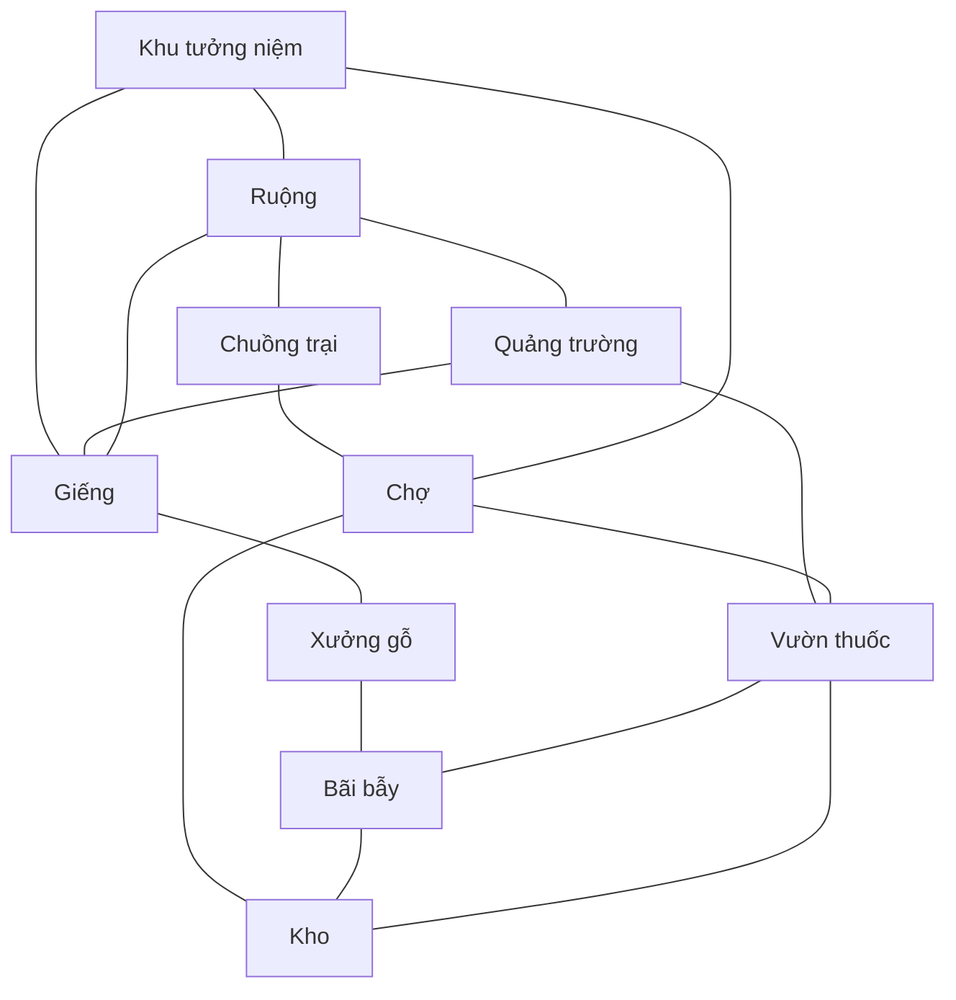

# Kế hoạch mở rộng map Làng — quy mô lớn

Ngày: **26/10/2026**
Trạng thái: **triển khai trên nhánh `thuong` theo yêu cầu; không merge vào `main`**

## Mục tiêu

Tạo một biến thể map lớn cho game social deduction, có nhịp di chuyển và độ phân tán gần cảm giác của Goose Goose Duck. Dùng Goose Goose Duck làm mốc tham khảo về trải nghiệm; không quy đổi trực tiếp đơn vị kích thước giữa hai game.

Map đề xuất là **Làng Mở Rộng** (`village_large`). Giữ `village` hiện tại trong lobby để có thể chơi thử và so sánh hai layout. Dùng lại bộ sprite trung cổ đang có trước; chưa cần thêm luật, vai trò hoặc task mới.

**Điều chỉnh theo yêu cầu mới:** revision 2 ưu tiên nhiều tuyến tới nhiệm vụ, đường nối trực tiếp giữa các khu và lối vòng qua quảng trường. Bỏ bức tường dài phía Tây, dùng quảng trường nhỏ và các vòng đường đan nhau; phân bố cây theo cụm có khoảng mở.

## Cách làm an toàn khi hai máy đang lệch phiên bản

Người dùng đã chọn tiếp tục từ **bản local hiện tại** và đẩy lên nhánh **`thuong`**. Chỉ thị này thay thế phương án chờ bản từ máy kia trước đó.

1. Fetch thông tin remote trước khi làm. `origin/thuong` tại `57290e4` là tổ tiên của bản local `8f25ece`, nên cập nhật nhánh local `thuong` bằng fast-forward tới `8f25ece`.
2. Triển khai map mới `village_large` trên `thuong`. Dùng menu **Install Large Village Only** để chỉ dựng map này và bổ sung catalog; giữ nguyên dữ liệu sáu map cũ.
3. Commit phần mở rộng map riêng để có thể mang sang bản ở máy kia sau này. Đẩy bình thường lên `origin/thuong`; không dùng force push.
4. Việc ghép với thay đổi chưa đẩy trên máy kia được thực hiện sau khi có commit của máy đó. Chưa có cơ sở xác nhận tương thích với các thay đổi chưa được chia sẻ.
5. Nhánh `main` không nằm trong đợt tích hợp này. Các commit merge `main` cũ đã có trong lịch sử bản local vẫn thuộc bản nền `8f25ece`.

### Giới hạn file dự kiến

| Nhóm | Hướng xử lý |
|---|---|
| Map mới | Thêm `village_large` dưới `Assets/Scenes/Thuong/Maps/` bằng pipeline hiện có |
| Map cũ | Không đổi prefab/definition `village` trong MVP |
| Runtime/collision | Chỉ sửa khi kiểm tra cho thấy hỗ trợ bounds hiện tại chưa đủ; thay đổi phải nằm trong commit riêng và giữ hành vi map cũ |
| Installer/catalog | Cập nhật để đăng ký map mới; kiểm tra output trước/sau để xác nhận asset cũ không bị tái tạo ngoài ý muốn |
| Protocol/task rules | Giữ nguyên ID/slot, protocol và luật; không tăng phạm vi trong lúc xử lý xung đột phiên bản |

## Cơ sở từ project

| Hạng mục | Hiện tại | Kế hoạch |
|---|---:|---:|
| Bounds map làng | 28 × 24 units (672 units²) | 42 × 36 units (1.512 units²), khoảng 2,25 lần diện tích |
| Bounds đề xuất | — | X: -20 đến 22; Y: -17 đến 19 |
| Tốc độ nhân vật | 3 units/giây | Giữ nguyên ban đầu |
| Trạm nhiệm vụ | 10 slot/task | Giữ đủ 10 slot/task; chỉ phân bố lại |
| Điểm spawn | 25 | Giữ 25 điểm gần quảng trường trung tâm |
| Camera gameplay | Orthographic size 6,5 | Giữ cỡ hiện tại; camera lấy bounds từ map definition |
| Đường đi được báo cáo | Spawn giữa tới trạm: 1,3–3,8 giây | Revision 2: gần 2,5–5 giây, trung vị 4–6 giây, xa nhất 6–10 giây |

Thời gian đường đi là tiêu chí thiết kế chính. Ở 3 units/giây, 8–10 giây tương ứng khoảng 24–30 units đi được; vật cản và đường vòng cần được tính bằng hệ thống collision thật.

## Bố cục hiện tại — revision 2

Giữ cụm spawn ở giữa với quảng trường nhỏ. Các khu có đường đá thành vòng và đường đất nối chéo qua các khu lân cận. Mọi nhiệm vụ phải có ít nhất ba hướng tiếp cận gần; các khu vẫn nối được với nhau khi chặn vùng quảng trường 7×7 units.

| Khu | Task đặt tại khu (ID/slot hiện có) | Vai trò trong layout |
|---|---|---|
| Quảng trường | Spawn; giếng phía Tây Nam, thuốc phía Đông | Mốc định hướng, nơi bắt đầu ván và nơi gặp nhau |
| Ruộng phía Bắc | Thu hoạch, Thu gom trứng, Sửa rào | Kéo một phần hoạt động ra khỏi khu trung tâm |
| Chợ phía Đông | Dọn kho, Thắp đèn | Cụm công trình dễ nhận ra, có lối vào và lối vòng |
| Rừng phía Nam | Gom củi, Gỡ bẫy | Khu có tầm nhìn ngắn hơn nhờ cây/công trình, nhưng vẫn có lối thoát |
| Khu tưởng niệm phía Tây Bắc | Bảo vệ khu vực | Có đường chéo và vòng qua hai phía, nối mạng đường phía Tây |

Tọa độ task đã được dựng và đo tuyến đi trong revision 2; số liệu nằm trong `Docs/ThuongLargeMapImplementation.md`. Duy trì khoảng trống quanh marker, nhãn, lối tương tác và các vị trí đông người.

## Hạng mục triển khai

| Giai đoạn | Công việc | Kết quả bàn giao |
|---|---|---|
| 1. Chốt blockout | Sao chép layout làng làm điểm xuất phát; dựng bounds 42×36; bố trí quảng trường, bốn khu, đường vòng và nhánh tắt | Bản blockout có thể đo đường đi và xem camera |
| 2. Phân bố gameplay | Đặt lại 10 task theo bảng trên; giữ 25 spawn ở trung tâm; đo từ spawn tới từng task và giữa các khu | Sơ đồ task/spawn cùng bảng thời gian đường đi |
| 3. Làm art | Mở rộng terrain và đường; thêm nhà, cây, hàng rào, cổng, biển chỉ dẫn bằng art hiện có; giữ pixel scale và thứ tự Y nhất quán | Prefab map lớn có thể chơi được, đủ điểm nhận diện |
| 4. Tích hợp | Tạo map ID `village_large`, definition, prefab, thumbnail và đăng ký catalog qua pipeline installer hiện có; cấu hình bounds/collider/camera; giữ nguyên slot và task ID | Map chọn được trong lobby; client dựng đúng cùng nội dung |
| 5. Chơi thử và cân bằng | So sánh với map làng hiện tại trong cùng phiên chơi; kiểm tra hướng đi, độ dễ nhận diện khu và thời gian hoàn thành task | Danh sách chỉnh sửa và số đo trước/sau |
| 6. Chốt phát hành | Chạy kiểm tra collision, map-ready, hiệu năng và rà soát hình ảnh; tăng `contentRevision` nếu sửa nội dung sau khi phát hành | Bản map đã nghiệm thu và ghi nhận giới hạn còn lại |

Ước lượng sơ bộ: **5–7 ngày công** nếu tái sử dụng art hiện có; art mới hoặc nhiều vòng sửa sau playtest sẽ làm tăng thời gian.

## Tiêu chí nghiệm thu

- Bounds thực của map là 42×36 units; camera không để lộ ngoài map và vẫn theo nhân vật đúng ở các tỷ lệ màn hình chính.
- Giữ 25 spawn hợp lệ gần quảng trường, 10 task hiện tại và đúng slot 0–9. Không đổi task mask, protocol hoặc luật role.
- Đo bằng walking-distance trên collision: từ spawn trung tâm tới task gần nhất khoảng 2,5–5 giây; trung vị của 10 task 4–6 giây; task xa nhất 6–10 giây. Chọn đường đi thuận tiện là ưu tiên của revision 2; không dùng tường dài để ép thời gian đi.
- Từ mọi spawn tới cả 10 task đều có đường đi hợp lệ; mỗi task có ít nhất ba hướng tiếp cận. Thử đi chéo, áp sát góc, bước di chuyển lớn và đi sát vật cản.
- Kiểm tra mạng đường đã vẽ cùng collider thật: mỗi nhiệm vụ vẫn tới được sau khi đóng một vùng 5,4×5,4 units ở giữa tuyến ngắn nhất. Các khu vẫn liên thông khi đóng quảng trường 7×7 units.
- Đường vòng ngoài liên thông; không có khu task nào chỉ vào được bằng một lối dễ chặn. Không để hành lang dài trống hoặc đường vòng chỉ tăng quãng đi mà không giúp định hướng.
- Host và client có cùng `mapId`/revision; client thiếu hoặc sai revision bị chặn sẵn sàng trước khi bắt đầu ván.
- Thử tối thiểu một host và một client riêng; kiểm tra thêm tải 25 avatar bằng cùng cấu hình và máy đo của baseline map cũ.
- Ghi lại tỷ lệ hoàn thành bốn task được chọn mỗi ngày và thời gian đi thực tế. **Giữ thời lượng ngày và tốc độ chạy như hiện tại ở vòng đầu**; chỉ đề xuất điều chỉnh sau khi dữ liệu playtest cho thấy cần thiết.
- So sánh frame time, bộ nhớ và overdraw cùng điều kiện với map cũ; nếu tăng đáng kể, tối ưu số SpriteRenderer/chi tiết xa trước khi phát hành.

## Rủi ro và cách xử lý

| Rủi ro | Xử lý |
|---|---|
| Map rộng nhưng chạy xuyên qua quá nhanh hoặc task thành chuyến đi quá dài | Chốt mục tiêu bằng thời gian đường đi; điều chỉnh vị trí task và lối tắt trước khi đổi movement speed |
| Người chơi lạc hoặc không biết mình đang ở khu nào | Dùng hình dáng công trình, palette phụ và biển chỉ dẫn riêng cho mỗi khu; đặt mốc nhìn thấy từ quảng trường |
| Nhiều vật cản làm đường tắt bị nghẽn | Duy trì vòng đường và các điểm cắt ngang; kiểm tra ít nhất ba hướng tiếp cận bằng footprint collision của nhân vật |
| Client chạy build khác dựng sai map | Dùng ID/revision hiện có và map-ready acknowledgement; cập nhật catalog cùng build cho cả phòng |
| Map lớn làm tăng chi phí render | Tái sử dụng tile/sprite, nhóm chi tiết trang trí, tránh phủ kín màn hình bằng cỏ/cây; so sánh cùng baseline |

## Phạm vi không đổi ở bản đầu

- Không thay map làng cũ; không xóa các map khác.
- Không thêm/bớt task, role, station slot hoặc thay đổi protocol.
- Không đổi tốc độ đi, thời lượng ngày hay luật sự kiện trước khi có số liệu playtest.
- Không lấy nguyên bản đồ/art của Goose Goose Duck; chỉ dùng làm mốc cảm giác về quy mô và khả năng định hướng.

## Nguồn trong project

- Map definition: `Assets/Scenes/Thuong/Maps/Definitions/village.asset`.
- Prefab và map catalog: `Assets/Scenes/Thuong/Maps/Prefabs/` và `Assets/Scenes/Thuong/Maps/Resources/ThuongMapCatalog.asset`.
- Bounds/camera: `Assets/Scripts/Thuong/Maps/ThuongMapDefinition.cs` và `Assets/Scenes/Thuong/Prototype/Scripts/ThuongTopDownCamera.cs`.
- Tốc độ đi: `Assets/Scripts/Thuong/Players-thuongnh/PlayerMovement.cs`.
- Kết quả baseline map hiện tại: `Docs/ThuongMapImplementationReport.md`.
