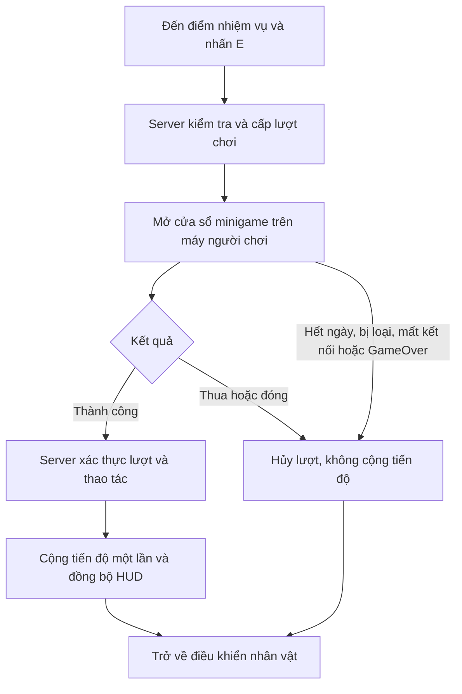

# Plan merge minigame vào Thương Online

**Trạng thái:** khảo sát và đề xuất; chưa nhập asset, thay gameplay hoặc merge Git.

**Mục tiêu:** gắn các minigame có sẵn vào điểm nhiệm vụ của Thương. Người chơi phải hoàn thành thử thách trước khi server cộng tiến độ; trận online, ngày/đêm và voice tiếp tục hoạt động bình thường.

## 1. Hiện trạng đã kiểm tra

Mốc khảo sát: `main`/`thuong` ở `57290e4`; remote ref đang lưu `origin/Bảo` ở `74aa307`. Khi triển khai cần fetch lại trước khi chọn nguồn.

| Minigame | Nguồn | Logic hiện có | Phần thiếu để tích hợp |
| --- | --- | --- | --- |
| Thu hoạch | `Assets/Minigames/Wheat Harvest/WheatHarvest.unity` | Chém lúa, cộng `Score`, có `IsGameOver`. | Thiếu mục tiêu kết thúc thành công. Khi thua có lệnh tải lại active scene theo build index. |
| Chặt gỗ | `Assets/Minigames/Chop Wood/ChopWood.unity` | Canh vị trí để chặt; điểm PERFECT/GREAT/OK. | Điểm đang private, chưa có vòng chơi, thành công/thất bại và callback hoàn thành. |
| Hứng trứng | `Assets/Minigames/Fruit Collect/Egg Collect.unity` | Hứng vật rơi cộng điểm; rơi xuống Ground thì thua. | `GameOver()` đặt `Time.timeScale = 0`; chưa có mục tiêu thành công hoặc callback. |
| Pha thuốc | `Assets/Minigames/Potion Making/PotionMaking.unity` | Thả 3 nguyên liệu, tính Healing/Poison rồi tạo `PotionResult`. | Kết quả chủ yếu ghi log/đổi màu; chưa so với công thức nhiệm vụ, chưa có callback/reset lượt. |
| Phòng thủ | `Assets/Minigames/Defender Game/Defend.unity` | Xoay khiên chặn vật thể; có tăng độ khó theo thời gian. | Va chạm Player còn TODO về sát thương/game over; chưa có máu, đếm chặn hoặc kết thúc thành công. |
| Trapsweeper | Chỉ có trên `origin/Bảo`, thư mục `Assets/Minigames/Trapsweeper` | `HunterTilemapManager`: bàn ô, cờ, gỡ ô an toàn, thắng/thua; `HunterInputController`: chuột/touch/zoom. | Chưa vào main; thắng/thua chỉ ghi log và giữ cờ private. Cần kết quả chuẩn, camera/input riêng và liên kết server. |

Trong main còn có bộ Minesweeper của Ilumisoft tại `Assets/Ilumisoft/Minesweeping`. Đề xuất giữ bộ demo này nguyên trạng; dùng Trapsweeper mới cho nhiệm vụ gỡ bẫy để tránh duy trì hai biến thể cùng lúc trong gameplay.

Các điểm nhiệm vụ Thương hiện là **Lấy nước, Thu hoạch, Sửa rào, Gom củi, Dọn kho, Thắp đèn**. Online đang gửi `CompleteTask` ngay khi nhấn E trong phạm vi; server gọi `TaskManager.TryCompleteTask`. Chưa có bước mở/chơi/xác nhận minigame.

## 2. Phạm vi nhập mã từ Bảo

1. Rà hai commit riêng `6bd18d3` (hunter minigame) và `74aa307` (Trapsweeper).
2. Ưu tiên nhập thư mục `Assets/Minigames/Trapsweeper` cùng `.meta` và các phụ thuộc thật sự được scene/prefab sử dụng. Ref đang lưu có 77 file trong thư mục này, chưa tính `.meta` của thư mục cha.
3. Commit `74aa307` còn sửa prefab `DefenderGameTiles.prefab`; phải kiểm tra dependency trước khi quyết định lấy phần này. Không coi mọi file trong commit là bắt buộc.
4. Bỏ các thay đổi không liên quan như `Assets/_Recovery`, xóa ảnh `tetoris.gif`, hoặc thay đổi ngoài phần minigame cần dùng.
5. Kiểm tra GUID trùng, GUID thiếu, MonoScript/prefab/sprite/tile reference và Git LFS. Giữ `.meta` của asset nhập vào; prefab/controller mới dành cho Thương có GUID mới.
6. Không đồng bộ cả cây thư mục từ Bảo sang main. Bản pha thuốc trên ref Bảo có cấu trúc khác main: có FallingIngredient/IngredientButton/UIIngredientButton thay vì DraggableIngredient. Chưa tự chọn thay bản main khi chưa rà riêng phần này.

Lịch sử có nhiều merge base; tránh dùng một kết quả diff ba chấm duy nhất để quyết định xóa/ghi đè asset. Đối chiếu thay đổi từng commit và tree hiện tại. Đây là lý do cần nhập chọn lọc thay vì merge nguyên nhánh Bảo.

`HunterGridManager`/`HunterTilemapManager` là tên controller minigame, không tự động liên quan kỹ năng của `HunterRole`. Không thay luật bẫy/trả thù của role khi tích hợp nhiệm vụ gỡ bẫy.

## 3. Luồng gameplay đề xuất

- Thua minigame chỉ là thất bại nhiệm vụ; không giết nhân vật và không gọi GameOver của trận.
- Không pause cả trận. Đồng hồ ngày vẫn chạy; chỉ khóa di chuyển và input của người đang làm nhiệm vụ. Server cũng khóa để không chỉ dựa vào client.
- Mỗi người chỉ có một lượt đang mở. Theo cơ chế nhiệm vụ chung hiện tại, một nhiệm vụ/ngày chỉ được cộng một lần; đề xuất khóa độc quyền lượt đang làm cho nhiệm vụ đó và nhả khóa khi hủy/thua.
- Nếu không còn đủ thời gian ban ngày cho thử thách tối thiểu, báo không thể bắt đầu. Khi sang đêm hoặc GameOver, đóng minigame trước khi hiện UI giai đoạn/kết quả.
- Thẻ xem role trước trận tiếp tục không giới hạn thời gian. Thời lượng minigame là cấu hình riêng, nằm trong thời gian ban ngày.

## 4. Cách ghép mà không phá scene chính

### 4.1. Runtime riêng cho Thương

Đề xuất tạo:

- `Assets/Scripts/Thuong/Minigames/`: controller mở/đóng, kết quả, cấu hình và adapter từng game, namespace `Thuong.Minigames`.
- `Assets/Scenes/Thuong/Prototype/Integration/Minigames/`: prefab phiên bản nhiệm vụ và dữ liệu mapping.
- `ThuongMinigameCatalog`: ánh xạ TaskData → minigame → mục tiêu/độ khó/thời lượng/thưởng. Dùng ID ổn định được serialize, không dùng AssetDatabase hoặc InstanceID trong build.
- `IThuongTaskMinigame`: vòng đời `Initialize`, `Begin`, `Cancel`, `Dispose`; trả `Succeeded`, `Failed`, `Cancelled`, `Expired` cùng dữ liệu kết quả có cấu trúc.

Ưu tiên composition/adapter. Với controller đang ghi trực tiếp `Time.timeScale`, gọi LoadScene hoặc không có API kết quả, tách phần logic cần thiết sang controller Thương có namespace riêng; không đọc private score bằng reflection hoặc sửa hàng loạt scene demo gốc.

### 4.2. Hiển thị và input

Giữ active scene là `OnlineSceneGamePlay`. Hiện code Thương sẽ đóng session khi active scene đổi sang tên khác, nên không mở minigame bằng LoadScene Single hoặc đổi active scene.

Đề xuất prefab minigame được tạo dưới root riêng trong một local scene có physics 2D riêng, hiển thị bằng camera riêng → RenderTexture → cửa sổ UI. Local scene không trở thành active scene.

- Gán camera trực tiếp trước khi bật prefab; thay các chỗ dựa vào `Camera.main` bằng reference của minigame.
- Dùng tọa độ tương đối với root; toàn bộ vật thể spawn nằm trong local scene/root để dọn được đầy đủ. PhysicsScene2D riêng cần được simulate đúng, không giả định Unity tự chạy giống default physics scene.
- Cô lập vùng render/vật lý, tránh vật thể có tag Player/Ground/Shield của game chính nhận nhầm va chạm. Không đổi collision matrix toàn project chỉ để ghép minigame.
- Chỉ dùng EventSystem của scene chính và một AudioListener đang hoạt động. Nhạc/SFX minigame dùng AudioSource riêng, không đổi voice hoặc singleton âm thanh của game khác.
- Pointer đi qua cửa sổ minigame, đổi tọa độ trong RawImage sang viewport của camera riêng; chặn click rơi xuống HUD hoặc minigame ngoài cửa sổ.
- Tắt/đóng minigame phải dọn coroutine, vật thể spawn, RenderTexture, callback và khóa input. Nút Thử lại/Hủy không reload scene hoặc tạo NetworkManager mới.

Input project hiện đang ở chế độ Both (`activeInputHandler: 2`), nhưng các game dùng lẫn Input cũ và Input System. Adapter Thương cần một đường input thống nhất cho chuột/touch, không đổi cấu hình input toàn project.

## 5. Đồng bộ và xác thực online

### Server giữ quyền cộng nhiệm vụ

- **Bắt đầu:** kiểm tra trận đang chạy, ban ngày, người còn sống, đúng khoảng cách, task thuộc danh sách hôm nay, chưa hoàn tất và chưa bị giữ lượt.
- **Cấp lượt:** lưu `attemptId`, người chơi, taskId, ngày/giai đoạn, thời điểm bắt đầu/hết hạn, bộ luật và trạng thái thử thách.
- **Kết thúc:** đối chiếu lượt còn hiệu lực, chủ sở hữu, ngày, trạng thái sống và kết quả thao tác; sau đó mới gọi `TaskManager.TryCompleteTask`.
- **Chống cộng trùng:** tiêu thụ attemptId một lần; khóa theo task/ngày, không chỉ theo một station index vì nhiều điểm có thể dùng cùng TaskData.
- **Đóng đường cũ:** task đã gắn minigame không được hoàn tất trực tiếp bằng action CompleteTask cũ. Task chưa gắn minigame có thể giữ cơ chế E hiện tại trong giai đoạn chuyển tiếp.
- **Hủy:** đổi giai đoạn, bị loại, hết hạn, ra khỏi phiên hoặc GameOver đều vô hiệu hóa lượt; gói kết quả gửi muộn không được cộng cho ngày mới.

Không chỉ nhận một boolean “tôi đã thắng” từ client. Với pha thuốc, server kiểm tra 3 nguyên liệu và công thức; với Trapsweeper, server giữ bàn bẫy riêng và xử lý yêu cầu mở/cắm cờ. Không gửi toàn bộ seed/bàn ẩn cho client rồi coi đó là chống gian lận.

Các game chặt gỗ/thu hoạch/hứng/phòng thủ cần tách luật tính điểm khỏi physics hiển thị: server kiểm tra thao tác, thời điểm, mục tiêu và tốc độ hợp lệ trên lịch sinh thử thách của mình. Không giả định replay Unity physics sẽ xác định tuyệt đối giữa các máy.

Đề xuất thông điệp minigame riêng có version cho begin/action/result/cancel. Tiến độ hoàn tất tiếp tục dùng snapshot/mask nhiệm vụ hiện có. Chỉ nâng version snapshot nếu bổ sung trường trạng thái chung; mọi thay đổi wire format phải đi cùng bản host/client mới.

## 6. Mapping và điều kiện hoàn thành đề xuất

Các ngưỡng dưới đây là điểm khởi đầu để cân bằng, chưa phải thông số đã triển khai.

| Minigame | Nhiệm vụ | Điều kiện đề xuất |
| --- | --- | --- |
| Chặt gỗ | Gom củi hiện có | Chặt đúng 5 khúc trong khoảng 15 giây; server xác thực cửa sổ thao tác. |
| Thu hoạch | Thu hoạch hiện có | Thu đủ số lúa cấu hình, ví dụ 8; chạm chướng ngại thì thất bại lượt. |
| Hứng trứng | Thêm nhiệm vụ Thu gom trứng/lương thực | Hứng đủ 10 vật; cấu hình số lần rơi cho phép và thời lượng. Không tự đổi tên Dọn kho khi chưa thống nhất nội dung. |
| Pha thuốc | Thêm nhiệm vụ Pha chế thuốc | Chọn đúng 3 nguyên liệu để đạt loại thuốc được giao. Trộn sai là thất bại minigame, không gây độc/đổi role trong trận. |
| Phòng thủ | Thêm nhiệm vụ Bảo vệ khu vực | Ví dụ sống sót 15 giây hoặc chặn đủ 10 đợt, có số lần trúng đòn cho phép. Cần hoàn thiện phần TODO trước. |
| Trapsweeper | Thêm nhiệm vụ Gỡ bẫy | Đề xuất bàn dễ 5×5, 3 bẫy, mở hết ô an toàn; giữ lần mở đầu an toàn. Thời lượng cần cân bằng với ngày. |

Lấy nước, Sửa rào, Dọn kho và Thắp đèn chưa có minigame khớp trực tiếp với nội dung hiện tại. Có thể giữ tạm cơ chế cũ hoặc thiết kế thêm sau; không tự gán game pha thuốc vào Lấy nước chỉ vì thiếu slot.

Giữ `progressValue` của nhiệm vụ và luật thắng tổng nhiệm vụ 100%; không để từng minigame tự gọi thắng trận. Nhiệm vụ hiện dùng mask 16 bit, nên thêm task/station phải kiểm tra giới hạn hiện có trước khi mở rộng danh sách.

## 7. Lộ trình thực hiện

| Bước | Công việc | Điều kiện bàn giao |
| --- | --- | --- |
| 1. Nhập nguồn chọn lọc | Rà Bảo, GUID/dependency/LFS; lấy Trapsweeper cần thiết, giữ 5 game hiện có và demo gốc. | Không mất reference hoặc ghi đè thay đổi ngoài phạm vi. |
| 2. Tạo khung minigame | Catalog, interface, cửa sổ, camera/physics/input riêng, khóa và giải phóng điều khiển. | Mở/đóng/lặp lại không reload scene, không dừng timer/mạng. |
| 3. Tích hợp đầu tiên | Gom củi/Chop Wood, sau đó Thu hoạch; nối server attempt và cộng nhiệm vụ. | Hoàn thành thật mới tăng tiến độ; thua/hủy/gửi lặp không tăng. |
| 4. Gỡ bẫy và pha thuốc | Bàn/công thức được server kiểm tra; kết quả và nút thử lại rõ ràng. | Không lộ bàn ẩn; không dùng log làm tín hiệu hoàn thành. |
| 5. Hứng và phòng thủ | Chuẩn hóa điểm, máu/lượt trượt, điều kiện thắng/thua, dữ liệu thao tác. | Không dùng timeScale toàn cục; hoàn thiện logic còn thiếu. |
| 6. Kiểm tra tích hợp | Offline, host/client, nhiều người, 25 người và đóng khi chuyển giai đoạn. | Đạt checklist dưới đây trước khi merge main. |
| 7. Đưa lên Git | Commit riêng từng bước; cập nhật thuong rồi merge vào main sau rà phạm vi. | Git merge sạch và nội dung main ngoài phạm vi không đổi. |

## 8. Checklist kiểm tra khi triển khai

- E mở đúng minigame, chưa tự cộng tiến độ; UI hiển thị hướng dẫn, mục tiêu, Hủy/Thử lại và kết quả nhiệm vụ.
- Thắng một lần, thua, thoát, hết hạn, reset lượt, đóng/mở lặp nhiều lần.
- Hai người cùng bắt đầu một task; một người mở hai lượt; nhận gói cũ, gói trùng hoặc sai chủ sở hữu.
- Người đang chơi bị loại, sang đêm, mất kết nối, người khác hoàn tất task hoặc ván kết thúc.
- Host và client đều giữ timer/ngày/đêm/voice; lỗi minigame không làm mất lobby hoặc đổi scene chính.
- Minigame cuối đưa tiến độ lên 100%: đóng cửa sổ nhiệm vụ và hiện đúng UI thắng/thua cá nhân, không hiện GameOver riêng của demo.
- Không có hai AudioListener/EventSystem hoạt động; không bắt nhầm camera/collider; không còn object/coroutine sau khi đóng.
- Chuột, touch, cửa sổ đổi kích thước; hiệu năng và đồng bộ khi 25 người tham gia.
- Prototype offline, scene Lợi, role Hunter và các scene minigame độc lập tiếp tục chạy như trước.
- Build kiểm tra nguồn prefab: các scene minigame hiện chưa nằm trong EditorBuildSettings. Nếu dùng prefab, không thêm hàng loạt scene vào build; nếu chọn additive asset scene thì đăng ký đúng scene cần thiết.

## 9. Cách merge Git đề xuất

1. Fetch main/Bảo/thuong; tạo nhánh tích hợp riêng từ main mới nhất, ví dụ `codex/thuong-minigame-integration`.
2. Commit nhập nguồn Trapsweeper chọn lọc; tiếp theo là khung Thương, từng game, rồi sửa tích hợp. Không merge nguyên cây Bảo, không reset main và không force-push.
3. Giới hạn diff vào nguồn minigame nhập có chủ đích, script/prefab/data Thương và tài liệu. Mọi thay đổi scene gốc, prefab dùng chung, TagManager hoặc BuildSettings cần có lý do cụ thể và được rà riêng.
4. Cập nhật main mới trước khi ghép vào thuong; giải quyết xung đột theo từng file, giữ GUID và dữ liệu của phần không liên quan. Không dùng ours/theirs hàng loạt cho scene/meta.
5. Biên dịch runtime/Editor, kiểm tra checklist tích hợp; sau đó cập nhật thuong và main theo quy trình đã dùng. Ghi rõ điều gì đã được chạy thử và điều gì còn chờ.

**Đề xuất chốt:** nhập Trapsweeper từ Bảo và xây khung nhiệm vụ trước; ghép Gom củi + Thu hoạch làm mẫu, sau đó mở rộng đủ sáu minigame. Những task không khớp nội dung được giữ tạm hoặc bổ sung task mới sau khi thống nhất mapping.
