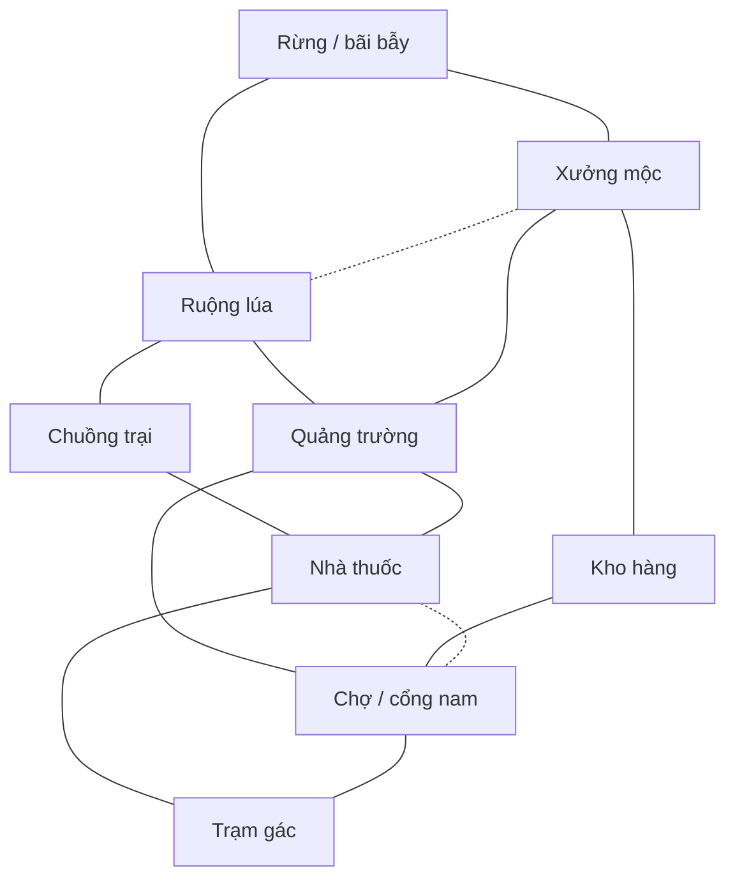

# Plan mở rộng map nhiều tuyến đường — Làng Liên Hoàn

Ngày lập: **27/10/2026**. Trạng thái: **kế hoạch tổng thể; bản đầu đã triển khai như cập nhật bên dưới**.

Cập nhật 27/10/2026: đã triển khai bản đầu `village_expanded` với 9 khu, 14 kết nối và 6 minigame. Xem [báo cáo triển khai](ThuongExpandedVillageImplementation.md) để biết nội dung thực tế, kiểm tra và các bước cần chơi thử; những phần còn lại dưới đây tiếp tục là kế hoạch.

Theo yêu cầu tiếp theo, cả năm map còn lại cũng đã có bản mở rộng riêng; xem [báo cáo các map mở rộng](ThuongExpandedMapsImplementation.md). Phần tăng lên 10–12 điểm nhiệm vụ và cân bằng bằng nhóm người chơi thật vẫn là chặng sau.

## 1. Hướng phát triển

Làm **một map Làng mở rộng có các vòng đường nối nhau**, sau đó áp dụng cách thiết kế đã chơi thử lên những map còn lại. Mục tiêu là để người chơi lựa chọn tuyến đường, gặp nhau ở nhiều khu, có điểm nhận diện để kể lại hành trình và có chỗ đặt thêm nhiệm vụ.

Phạm vi bản đầu:

- 9 khu vực, 14 kết nối hai chiều; có vòng ngoài, đường xuyên trung tâm và 2 lối cắt công khai.
- 6 trạm cho 6 minigame sẵn có, phân bố trên các nhánh khác nhau.
- Chừa vị trí cho tổng cộng 10–12 điểm nhiệm vụ ở bản sau.
- 25 điểm spawn hợp lệ; chơi thử trước với 8–16 người, sau đó kiểm tra 20–25 người.
- Giữ phong cách làng trung cổ pixel art và tận dụng art hiện có.

Nguồn cảm hứng: trang chính thức [Goose Goose Duck](https://store.steampowered.com/app/1568590/Goose_Goose_Duck/) mô tả nhiệm vụ, minigame và môi trường đa dạng; [The Fungle của Among Us](https://www.innersloth.com/new-map-the-fungle-out-now-emergency-meeting-38/) kết hợp bãi biển, rừng, vách cao, nhiệm vụ và zipline. Thiết kế dưới đây là đề xuất riêng cho project, không phải bản sao layout hoặc thông số cân bằng của hai game đó.

## 2. Hiện trạng đã đối chiếu trong project

| Hiện trạng | Ý nghĩa với plan |
| --- | --- |
| Catalog có `village`, `harvest_market`, `lantern_cemetery`, `mist_swamp`, `woodland_camp`, `abandoned_manor` | Có thể tái sử dụng hệ thống chọn map, bind world và event |
| Làng có bounds từ `(-13,-11)` tới `(15,13)`, khoảng 28 × 24 world unit | Bắt đầu thử 40 × 34, khoảng gấp đôi diện tích; chỉ thử 48 × 40 khi số đo cho thấy cần thêm không gian |
| Thumbnail Làng hiện có quảng trường rộng, sáu cụm nhà và nhiều đường thẳng | Cần tạo các cụm địa hình có chức năng, tăng lựa chọn đi vòng và thay đổi hướng |
| `ThuongMapValidator.Validate` yêu cầu đúng 6 trạm và các `TaskData` khác nhau | Thêm đường có thể làm trước; thêm trạm phải sửa hợp đồng dữ liệu và kiểm tra liên quan |
| Sáu minigame: chặt gỗ, thu hoạch, trứng, pha thuốc, bảo vệ, gỡ bẫy | Đủ để kiểm chứng layout đầu tiên |
| `TaskManager.tasksPerDay = 4`; danh sách task và tiến độ đang dùng chung trong trận | Không mặc định mỗi người có 4 nhiệm vụ riêng như một game khác |
| Online dùng `ushort` cho trạng thái nhiệm vụ, tối đa 16 slot theo cấu trúc hiện tại | 10–12 điểm có thể nằm trong giới hạn số bit, nhưng phải sửa binding, định danh và logic hoàn thành |
| Scene `OnlineSceneGamePlay` cấu hình ngày 45 giây; scene `Loi/Game` cấu hình 120 giây | Hai luồng cần ngân sách thời gian riêng; không lấy một thời lượng làm kết luận cho toàn game |
| Online Thương hiện cho đi lại trong pha Day; minigame cũng kiểm tra pha Day | Đường phục vụ di chuyển/làm task trước; truy đuổi hoặc giết tự do cần thiết kế gameplay riêng |
| Server đã có swept collision, kiểm tra khoảng cách/đường tiếp cận trạm, map ID/revision/epoch và map-ready | Mở rộng trên nền hiện có, giữ server quyết định vị trí và kết quả nhiệm vụ |
| Camera đã có follow, clamp theo bounds và chế độ overview | Cập nhật bounds và kiểm tra overview khi map lớn hơn |

**Scene thử nghiệm đề xuất:** `Assets/Scenes/Thuong/OnlineSceneGamePlay.unity`, vì đây là luồng đang dùng bộ map trên. Build Settings hiện liệt kê các scene của Lợi, gồm `Assets/Scenes/Loi/Game.unity`; cần xác nhận luồng chạy và kiểm tra tích hợp trước khi đưa map vào bản build chính.

Tài liệu map cũ có đoạn nói 10 trạm; plan này lấy code hiện tại yêu cầu **6 trạm** làm mốc.

## 3. Sơ đồ 9 khu vực

Sơ đồ mô tả kết nối, không thể hiện tỷ lệ hoặc vị trí chính xác của đường trong Unity. Mọi cạnh đều đi hai chiều; nét đứt là lối cắt công khai.

Danh sách kết nối chuẩn: A–B, B–C, C–F, F–I, I–H, H–G, G–D, D–A, B–E, D–E, E–F, E–H, D–B, F–H. Tổng cộng **14 kết nối**.

- **Vòng ngoài:** Rừng → Ruộng → Chuồng → Nhà thuốc → Trạm gác → Chợ → Kho → Xưởng → Rừng.
- **Đường xuyên trung tâm:** Xưởng ↔ Quảng trường ↔ Nhà thuốc và Ruộng ↔ Quảng trường ↔ Chợ.
- **Lối cắt 1:** Xưởng ↔ Ruộng qua hẻm sau nhà/kho nông cụ.
- **Lối cắt 2:** Nhà thuốc ↔ Chợ qua vườn và cầu nhỏ.

Ví dụ từ Xưởng sang Nhà thuốc có ba lựa chọn: qua Quảng trường; vòng bắc qua Rừng–Ruộng–Chuồng; vòng nam qua Kho–Chợ–Trạm gác. Nhiệm vụ và cảnh quan trên mỗi nhánh tạo lý do lựa chọn tuyến.

Quảng trường vẫn là nơi xuất phát nhưng không phải cửa ngõ bắt buộc. Khi bỏ Quảng trường khỏi sơ đồ, tám khu còn lại vẫn nối thành vòng. Khi một đoạn đường bị chặn trong kiểm tra thiết kế, các khu nhiệm vụ vẫn phải còn đường tới nhau. Chưa thêm cửa đóng hoặc sự kiện chặn đường trong bản đầu.

## 4. Chức năng, object và nhiệm vụ từng khu

| Khu | Object nhận diện và tạo đường | Nhiệm vụ bản đầu | Vị trí dành cho bản sau |
| --- | --- | --- | --- |
| Quảng trường | Giếng hoặc tượng lệch khỏi vùng spawn, bảng chỉ hướng, đèn, ghế ven sân | Khu xuất phát, điều hướng; không gom task tại đây | Bảng thông tin hoặc điểm nhận chuỗi nhiệm vụ |
| Rừng / bãi bẫy | Cây thành cụm, gốc cây, bẫy, lều nhỏ; giữ đường vòng quanh cụm cây | Gỡ bẫy | Thu thảo dược; thêm trạm cứu hộ nếu có minigame |
| Ruộng lúa | Luống cây, rơm, cối xay hoặc nhà nông cụ; hai lối vào khác phía | Thu hoạch | Tưới cây hoặc sửa kênh nước |
| Chuồng trại | Chuồng gà, ổ trứng, máng ăn, hàng rào mở hai đầu | Thu gom trứng | Cho ăn hoặc sửa rào |
| Xưởng mộc | Bàn cưa, đống củi, khúc gỗ; có đường trước xưởng và hẻm sau | Chặt gỗ | Sửa xe hàng hoặc ghép ván |
| Nhà thuốc | Bàn pha chế, chậu cây, giá lọ; hai cửa hoặc sân có hai lối | Pha thuốc | Phân loại nguyên liệu |
| Kho hàng | Thùng, bao tải, xe kéo tạo hai lối vòng; điểm làm task thụt vào bên đường | Khu đi qua và chỗ chờ nhiệm vụ mới | Xếp hàng, chuyển hàng qua khu khác |
| Chợ / cổng nam | Quầy nhiều màu, biển khu, đèn, sân xe; đường vòng phía sau quầy | Nút giao nam, điểm nhận diện | Giao hàng hoặc phân loại hàng |
| Trạm gác | Cột cờ, chuông, bảng gác, sân nhỏ có đường vào từ bắc/tây | Bảo vệ khu vực | Sửa đèn hoặc kéo chuông bằng minigame |

Mỗi khu chỉ cần một vài object nổi bật và các cụm đạo cụ phụ. Thùng, cây hoặc hàng rào dùng để định hình tuyến; không rải ngẫu nhiên cho đầy bản đồ. Những điểm dự phòng chưa có gameplay chỉ là vị trí trong thiết kế, chưa bật marker nhiệm vụ.

## 5. Quy tắc dựng địa hình

Các số dưới đây là **mốc blockout để thử**, chưa phải kết quả nghiệm thu:

- Đường chính rộng khoảng 2,5–3,5 world unit; đường phụ 1,5–2; cửa/lối nối khoảng 1,2–1,5. Đo phần trống thực tế sau khi tính footprint người chơi và collider đạo cụ.
- Hai lối vào một khu phải dẫn về hai tuyến khác nhau. Hai cửa nằm cạnh nhau nhưng cùng đổ vào một hành lang cụt chưa tạo lựa chọn đường đi.
- Chỗ bấm nhiệm vụ nằm trong một khoảng sân hoặc hốc bên đường, tránh đặt ngay giữa cửa và ngã ba. Kiểm tra khoảng tương tác online hiện tại 1,3 unit để tránh bấm nhầm trạm ở phía bên kia tường/hàng rào.
- Dùng cụm nhà, vườn và hàng rào để tạo góc rẽ; mỗi tuyến có mốc nhận diện như xe đỏ, cầu gỗ hoặc chuồng gà.
- Dành đường ra thứ hai cho mọi khu có nhiệm vụ bắt buộc. Ngõ cụt trang trí được phép tồn tại nhưng ngắn và dễ nhận ra.
- Collider theo chân nhà, thân cây và vật cản thật; mái/tán không tạo vật cản vô hình. Đồ cao cần sắp lớp và giảm che khuất phù hợp.
- Lối tắt nối hai vùng có khoảng cách đi bộ đáng kể; thử mức tiết kiệm 20–30% cho cặp điểm liên quan rồi đo mức sử dụng. Tránh một lối tắt trở thành lựa chọn tốt nhất cho mọi hành trình.
- Giữ đủ 25 spawn không trùng nhau, không chồng trạm/vật cản; đặt đèn/sân khấu event ngoài lối đi và vùng tương tác.

**Phân biệt hình ảnh và luật:** `ThuongMapOccluder` giảm che nhân vật, không phải hệ thống tầm nhìn. Event sương cũng chưa giới hạn thông tin server. Chưa lấy “góc khuất”, “sói không bị thấy” hoặc “vật cản chặn voice” làm lợi thế gameplay nếu chưa có hệ thống tương ứng. Hiện collision map không dùng collider người chơi, nên đường hẹp cũng chưa có luật chặn nhau bằng thân người.

## 6. Cân bằng thời gian và phân bố nhiệm vụ

### Bản đầu: 6 trạm, chọn 4 nhiệm vụ/ngày như hiện tại

Đặt trạm gỡ bẫy ở Rừng, thu hoạch ở Ruộng, trứng ở Chuồng, chặt gỗ ở Xưởng, pha thuốc ở Nhà thuốc, bảo vệ ở Trạm gác. Kho và Chợ ban đầu giúp hoàn thành mạng đường và dành chỗ mở rộng nội dung.

Khi bốc bốn nhiệm vụ, mục tiêu thiết kế sau này là có nhiệm vụ ở ít nhất ba khu; tránh tất cả công việc của một ngày chỉ nằm trên một nhánh. Đây là thay đổi thuật toán chọn task cần triển khai riêng, vì hiện tại hệ thống đang random từ danh sách chung.

| Số đo theo đường đi thật, tốc độ online 3 unit/giây | Mục tiêu thử |
| --- | --- |
| Spawn tới trạm gần | 3–5 giây |
| Spawn tới trạm xa | 8–12 giây |
| Hai khu liền kề | Khoảng 3–6 giây |
| Băng qua map theo tuyến hợp lý | Khoảng 15–20 giây |

Đo tới vùng tương tác, không dùng khoảng cách đường thẳng tới tâm icon. Ghi riêng thời gian chạy, làm minigame, chờ và quyết định đường đi.

Với scene online 45 giây, chạy tới một trạm xa trong 12 giây đã chiếm khoảng 27% thời gian Day. Ưu tiên sửa bố cục và phân bố task trước; nếu vẫn thiếu thời gian, tạo cấu hình thử 60/75 giây cho map mở rộng, đối chiếu với mốc 45 giây. Scene Game 120 giây cần được chơi thử bằng luồng của chính nó. Chưa tự tăng thời lượng ngày trong toàn project.

Tiến độ đang dùng chung: phải đánh giá khả năng phối hợp của cả nhóm, số người đi làm task và tốc độ thắng, không giả định một người cần hoàn thành cả bốn nhiệm vụ. So sánh tỷ lệ hoàn thành, thời gian đạt tiến độ thắng và tỷ lệ thắng hai phe với map cũ; ghi số liệu trước khi đặt ngưỡng cân bằng cuối.

### Bản sau: 10–12 điểm, 8–10 nội dung nhiệm vụ

- Tái sử dụng sáu minigame; thêm trước hai minigame như phân loại hàng và sửa đèn. Các nhiệm vụ còn lại đưa vào backlog theo kết quả chơi thử.
- Có thể có hai địa điểm dùng chung một loại minigame, nhưng mỗi điểm cần định danh riêng.
- Thử một chuỗi ngắn Kho → Chợ hoặc Ruộng → Nhà thuốc để tạo lý do di chuyển giữa các khu. Server giữ trạng thái từng bước và chỉ cấp tiến độ một lần khi hoàn tất chuỗi.
- Mọi nhiệm vụ mới có thao tác minigame phù hợp; nút tương tác mở nhiệm vụ, không tự cộng tiến độ.
- Giữ thiết kế nhiệm vụ dùng chung làm mặc định. Nếu muốn danh sách cá nhân, đó là thay đổi riêng về phân công, đồng bộ trạng thái và điều kiện thắng.

## 7. Công việc kỹ thuật theo mức cần thiết

### Làm trước để thử đường đi

1. Tạo layout riêng `village_expanded`, definition/prefab/thumbnail riêng để đối chiếu với `village` cũ. Giữ đúng sáu task ID và slot hiện có ở bản đầu.
2. Viết nhánh dựng layout mở rộng trong công cụ map; lưu bounds, vật cản, spawn, trạm, đèn và sân khấu vào cùng nguồn cấu hình. Không chỉ sửa prefab bằng tay vì installer có thể dựng lại.
3. Cập nhật camera bounds, kiểm tra tỷ lệ màn hình và overview. Nếu overview hiển thị mọi avatar khi chơi, cần quyết định lại thông tin nào được phép thấy khi có luật tầm nhìn về sau.
4. Giữ kiểm tra va chạm và tương tác tại server; client không tự hoàn thành task hoặc tự chọn vị trí cuối cùng.
5. Tăng revision nội dung theo thay đổi. Installer hiện gán revision cố định theo map index; cần sửa cách quản lý revision trước khi dùng để phát hành nhiều lần.
6. Kiểm tra map-ready khi đổi map hoặc sai revision; kiểm tra lại sáu event và chế độ thường với layout mới.

Map thử có thể đặt `released = false` trong lúc làm nội dung. Catalog hiện chỉ tìm/chọn map đã released, nên cần đường bind trực tiếp trong scene/harness thử nghiệm; chỉ thêm vào pool lobby khi đạt kiểm tra.

### Làm trước khi tăng số trạm

1. Tách `stationId` (điểm vật lý), `taskId` (nội dung nhiệm vụ) và `minigameKind` (kiểu minigame). Dù đã có trường `stationId`, installer hiện gán nó bằng `taskId`; chưa thể coi các khái niệm này độc lập.
2. Sửa validator đang yêu cầu đúng sáu trạm, task không trùng và slot liên tục; thay bằng hợp đồng phù hợp số trạm từng map. Cập nhật kiểm tra đang yêu cầu các map có cùng danh sách slot/task.
3. Xác định rõ: hai trạm cùng phục vụ một task là hai lựa chọn thay thế, hay hai task độc lập. Với plan này, ưu tiên các task instance độc lập và vẫn dùng tiến độ chung của nhóm; mỗi instance có ID và trạng thái hoàn thành riêng.
4. Cập nhật `TaskManager`, mask, mapping minigame và dữ liệu server/client cùng nhau. `HashSet<TaskData>` hiện tại không biểu diễn được hai instance độc lập dùng chung một TaskData.
5. Giữ 10–12 slot trong giới hạn 16 nếu có thể. Nếu cần hơn 16, đổi định dạng truyền và tăng phiên bản giao thức; không chỉ tăng số phần tử trong Inspector.
6. Bổ sung dữ liệu vùng và đồ thị kết nối, ví dụ `MapZone`/`MapConnection`, phục vụ tên khu, chọn task theo khu và kiểm tra topology. Đây là cấu trúc mới được đề xuất.

Kiểm tra hiện tại đếm hai hướng tiếp cận gần trạm và xác nhận đường đi tới trạm. Cần thêm kiểm tra **hai tuyến nối thật sự khác nhau giữa các khu**; hai ô đứng bên cạnh một trạm chưa chứng minh map có nhiều tuyến.

Với map lớn hơn, theo dõi thời gian chạy kiểm tra đường. `WalkingDistances` đang tìm node nhỏ nhất bằng quét toàn bộ lưới; nếu kiểm tra chậm, dùng lại lưới/đồ thị và hàng đợi ưu tiên trước khi nhân kiểm tra cho mọi spawn. Không đưa phép đo đường đầy đủ vào mỗi frame gameplay.

## 8. Lộ trình triển khai và điều kiện xong

Ước lượng sơ bộ cho một người có thể làm Unity và tận dụng art sẵn có; đây là ngày công, chưa phải lịch cam kết. Chưa gồm chờ người chơi, vẽ asset riêng và xử lý lỗi ngoài phạm vi map.

| Chặng | Công việc | Đầu ra / điều kiện xong | Ước lượng |
| --- | --- | --- | --- |
| R0 — Chốt thiết kế | Xác nhận scene chạy, số người thử, ngân sách Day; chốt 9 khu và 14 kết nối | Sơ đồ, danh sách nhiệm vụ, mốc đo; biết map vào build nào | 0,5 ngày |
| R1 — Dựng khối thô | Dùng nền màu/khối đơn giản dựng 9 khu, 14 nối, 6 trạm, 25 spawn ở kích thước thử 40 × 34 | Đi được toàn map, có ba tuyến tây–đông; không mắc kẹt hoặc xuyên vật cản | 1–2 ngày |
| R2 — Hoàn thiện tuyến và cảnh | Nhà/cây/hàng rào theo cụm; landmark, collider chân, sân nhiệm vụ, event anchors | Mỗi khu có hai đường nối khác phía, task không chắn đường, nhận ra khu khi camera follow | 2–3 ngày |
| R3 — Tích hợp online và chỉ dẫn | Definition/runtime/camera, revision, tên khu/biển chỉ hướng, marker task, kiểm tra đổi map/event | Host/client cùng nội dung, tương tác đúng; bản thường và 6 event hoạt động | 1–2 ngày |
| R4 — Chơi thử và chỉnh | Thử 8–16 người, sau đó 20–25; đo tuyến sử dụng, thời gian và tiến độ task | Có báo cáo so map cũ, sửa tuyến ít dùng và task quá xa, kiểm tra build đúng luồng | 2–3 ngày |
| R5 — Tăng nội dung | Tách ID, task instance, thêm 2 minigame và mở 10–12 điểm | Không trùng tiến độ, không sai mask; có kiểm tra server/client cho nhiệm vụ mới | Ước lượng riêng sau R4; dự trù thêm 5–8 ngày công |

**Mốc chơi thử đầu tiên:** hoàn tất R1. **Mốc map thử nghiệm hoàn chỉnh với sáu minigame:** R0–R4, khoảng 7–11 ngày công theo giả định trên. R5 triển khai sau khi layout đã cho thấy nhiều tuyến có người sử dụng.

## 9. Checklist nghiệm thu

- [ ] Mỗi spawn tới được cả sáu trạm bằng đường hợp lệ; không xuyên tường/nước và không tương tác xuyên vật cản.
- [ ] Tám khu ngoài vẫn liên thông khi bỏ tuyến qua Quảng trường khỏi phép kiểm tra.
- [ ] Bỏ từng kết nối chính trong đồ thị vẫn không cô lập khu nhiệm vụ; đối chiếu đồ thị với collision thật.
- [ ] Hai cửa của mỗi khu dẫn tới hai tuyến khác nhau; tránh lối vào thứ hai chỉ quay lại cùng hành lang.
- [ ] Đo thời gian theo đường thật đạt mục tiêu thử hoặc có lý do điều chỉnh; ghi cả thời gian minigame.
- [ ] Ghi lượt đi qua từng kết nối, lượt tới từng khu và nhóm task được chọn. Tuyến ít dùng được xem lại trước khi bổ sung art.
- [ ] Người mới tìm được khu/trạm bằng tên, landmark và chỉ dẫn sau vài lượt; kiểm tra task HUD ở màn hình nhỏ.
- [ ] Camera follow/overview, mái/tán cây và nhãn nhiệm vụ vẫn đọc được trong ban ngày, ban đêm và sáu event.
- [ ] Đổi map, rời phòng, vào lại, sai revision và snapshot lặp không làm nhân đôi world/trạm/event hoặc mở khóa sai.
- [ ] Chạy được từ luồng build dự kiến; thử hai máy thật/mạng thật, không coi loopback là đủ.
- [ ] So sánh thời gian frame trên thiết bị mục tiêu với map cũ trong cùng điều kiện; kiểm tra khi có 20–25 người và minigame đang mở.
- [ ] Có dữ liệu chơi thử về tiến độ chung và tỷ lệ thắng, trước khi quyết định tăng Day hoặc thêm luật map.

## 10. Thứ tự mở rộng tiếp theo

Sau khi Làng mở rộng đạt R4, áp dụng các nguyên tắc đã kiểm chứng cho Chợ Mùa Gặt rồi Trại Rừng. Giữ bản sắc từng map: Chợ dùng vòng trước/sau quầy; Trại Rừng dùng đường trại, đường rừng và cầu; Nghĩa Trang dùng các cụm mộ và sân tưởng niệm. Đầm Sương cần đặc biệt tránh cầu duy nhất cô lập một khu; Dinh Thự cần kiểm tra phòng, hành lang và mái/tường che nhân vật.

Hầm dành cho vai, cửa đóng theo sự kiện, phá hoại, tầm nhìn thật và truy đuổi tự do là các hạng mục sau, vì chúng thay đổi quyền di chuyển hoặc luật trận. Hai lối cắt công khai của bản đầu giúp kiểm chứng mạng đường trước khi thêm các cơ chế này.

## 11. File tham chiếu đã đọc

- `Assets/Scenes/Thuong/Maps/Art/Thumbnail_village.png`
- `Assets/Scenes/Thuong/Maps/Definitions/village.asset`
- `Assets/Scripts/Thuong/Maps/ThuongMapDefinition.cs`
- `Assets/Scripts/Thuong/Maps/ThuongMapValidator.cs`
- `Assets/Scripts/Thuong/Maps/ThuongMapRuntime.cs`
- `Assets/Scripts/Thuong/Maps/ThuongMapCatalog.cs`
- `Assets/Scenes/Thuong/Prototype/Editor/ThuongMapInstaller.cs`
- `Assets/Scenes/Thuong/Prototype/Editor/ThuongMapChecks.cs`
- `Assets/Scenes/Thuong/Prototype/Scripts/ThuongTopDownCamera.cs`
- `Assets/Scripts/Thuong/Tasks-thuongnh/TaskManager.cs`
- `Assets/Scripts/Thuong/Minigames/ThuongMinigameCatalog.cs`
- `Assets/Scripts/Thuong/Online/ThuongOnlineSession.cs`
- `Assets/Scripts/Thuong/Online/ThuongOnlineMinigames.cs`
- `Assets/Scripts/Thuong/Online/ThuongOnlineMaps.cs`
- `Assets/Scenes/Thuong/OnlineSceneGamePlay.unity`
- `Assets/Scenes/Loi/Game.unity`
- `ProjectSettings/EditorBuildSettings.asset`

Các thông số kích thước, thời gian đi bộ và ngày công trong plan là đề xuất để đo và điều chỉnh. Việc rà soát lần này chưa chạy Unity, build hoặc chơi thử layout mới.
